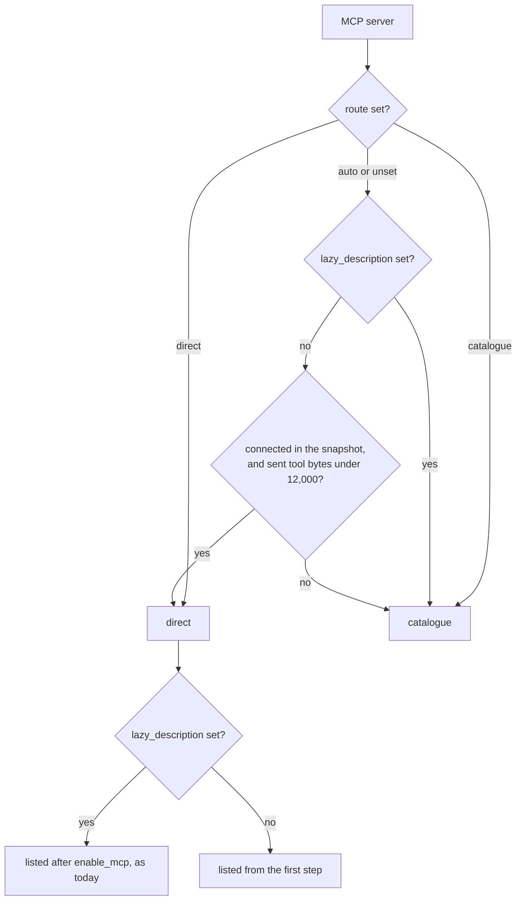
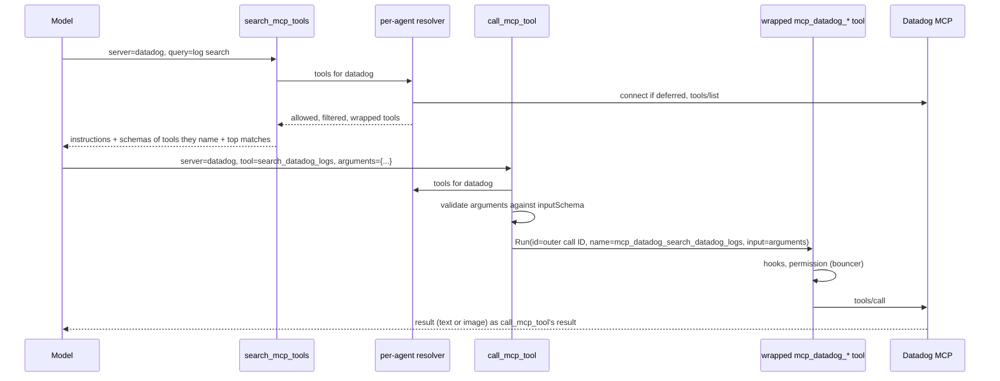

# MCP Tool Catalogue Design Doc

**TL;DR:** MCP tools reach the model through a catalogue by default. Three fixed tools, `search_mcp_tools`, `describe_mcp_tool` and `call_mcp_tool`, find a tool, return its schema as a tool result and run it, so a server's schemas never enter the tool list. Anvil lists a server's tools directly only when they are small, trading a little money for latency on servers like code search. It decides once per process from the schema size, so nobody has to maintain per-server modes. The spike behind this (`plans/completed/spike-2026-10-23-mcp-catalogue-cost.md`) found no routing mistakes when direct and catalogue routes were mixed. The mixed setup closest to what ships cost 37% to 38% less than today's lazy loading.

**Problem:** A server's tools cost tokens on every request once they're listed, and agents use very few of them.
- **Production data:** `step_usage` and `messages` from 2026-10-10 to 2026-10-23 (46k rows, 1,458 sessions) show:
  - An enabled lazy server adds 28k to 413k tokens to every later request.
  - Sessions call an average of 1.6 to 3.2 of each server's 27 to 463 tools.
  - Datadog's schemas alone cost about $335 over the period.
- **After the Datadog narrowing:** its 85 tools still measure about 103k tokens.
- **Why the obvious fixes fall short:**
  - Narrowing `toolsets` and `enabled_tools` allow-lists need someone to predict which tools future tasks need, and keep the list current as tasks and servers change.
  - Today's lazy loading (`enable_mcp`) defers the cost but then pays it on every remaining step of the session, plus a cache miss.

**Goal:** With no per-server configuration, a session pays roughly for the schemas and results of the MCP tools it actually uses. Every tool on every server stays reachable, and the tool list (and so the cached prefix) stays identical from a session's first step to its last.

**Scope:**
- In:
  - A per-server `route` setting (`auto`, `catalogue`, `direct`), defaulting to `auto`, and the size rule `auto` applies.
  - The three catalogue tools and their `.md` descriptions, including schemas for tools a server's instructions name.
  - Connecting a deferred catalogue server on first use, including `mcp.WaitSettled`.
  - Permissions, the bouncer, hooks, timers and the UI treating a proxied call as the inner MCP tool.
  - Subagents and workflow agents.
  - Showing each server's route and the reason for it in `anvil_info` and the MCP palette.
  - Docs: `docs/configuration.md`, `GLOSSARY.md`, `AGENTS.md`, an ADR, and a note that existing lazy servers move to the catalogue by default.
- Out:
  - **Routing from usage history.** Declined (see Decisions). A usage counter can be added later if the size rule puts a server on the wrong side.
  - **Per-agent routes.** The route belongs to the server, and `allowed_mcp` already narrows what each agent sees.
  - **Provider tool search** (Anthropic `defer_loading`, OpenAI `tool_search`). fantasy v0.45.2 has no support, and it only covers some models. The catalogue is the provider-agnostic base that native search could later sit under.
  - **Code mode** (running MCP tools from a script).
  - **Headless `tools/list_changed` refresh,** an existing gap.

Also in scope, since direct listing stays the default for small servers: an MCP tool's parameters are normalised once, when `mcp/tools.go:updateTools` registers the server's tools, on a private deep copy.
- **The bug:** today `Tool.Info()` aliases the shared `InputSchema` (`mcp-tools.go`), and fantasy's `prepareTools` runs `schema.Normalize` on `info.Parameters` in place. `Normalize` recurses, turning type arrays into `anyOf` and adding missing `items`.
- **Symptoms:** `tools_hash` changes after the first step whenever MCP tools are listed (the spike saw it in every direct and mixed run). Concurrent sessions normalising the same tool for the first time can hit Go's fatal "concurrent map writes".
- **The fix:**
  - The `allTools` registry stores an entry holding the raw SDK tool (for `InputSchema()`, describe and validation) next to the normalised `properties` and `required`.
  - `Info()`'s extraction moves into `mcp`, so the sent-bytes size and `Info()` use one function.
  - Its three readers (`GetMCPTools`, `refreshMCPTools`, `enable_mcp`'s count) read the entry. `GetMCPTools` rebuilds wrappers on every build, so normalising there would not be "once".
  - Once normalised, `Normalize` only reads, so later calls are free and race-free.
  - A `-race` test covers both two sessions on one wrapper and two wrappers from separate `GetMCPTools` calls, since the orchestrator's and a subagent's wrappers share one registry entry.

**Constraints:**
- **Stable prefix for catalogue routing.** Within a process, the route map and the catalogue tools' descriptions are fixed when the route snapshot is taken (see Design). They don't change when a server is searched, called, connected, reconnected, renewed, re-listed (`tools/list_changed`) or toggled in the palette, or when a config reload edits `route`, `lazy_description` or the server set. Edits to an agent's `mcps:` or `disabled_tools` still change that agent's tools on reload, as they do today.
  - Catalogue routing therefore never changes the tool list or the system prompt.
  - Direct servers keep today's behaviour: their tools and instructions come and go with their connection state, as they do now.
- **Layering** (`AGENTS.md`). The catalogue and the route rule live in the `agent` layer. `internal/agent/tools/mcp` reports schema sizes but knows nothing about routes. Argument validation uses `github.com/google/jsonschema-go`, already a direct dependency.
- **One identity.** Every existing control applies to a proxied call exactly as it does to a directly listed MCP tool, under the same name `mcp_<server>_<tool>`:
  - permission globs,
  - bouncer review,
  - `allowed_mcp`,
  - `enabled_tools` and `disabled_tools`,
  - top-level hooks (hooks never run in subagents, `hooked_tool.go`),
  - the OAuth PascalCase rename.
- **Mutation-friendly code.** New code stays under `gocognit` 30 and survives the mutation check. Search ranking and every server list must be deterministic: sort, never range over a map into output. Pin the size threshold's boundary in tests.

**Design:**

**Choosing a route.** Each server resolves to `direct` or `catalogue` once per process, from a snapshot taken when `mcp.Initialize` finishes:



- **The snapshot.** `mcp.Initialize` records, just before it closes `initDone`, each configured server's state and the size of its tools. It has already waited out every connect attempt, so no non-lazy server is still starting.
  - `Initialize` captures each server's `MCPConfig` from the same `cfg.Config()` it iterates and stores it in the snapshot, a data copy with no routing logic. The agent layer derives the route map from the snapshot alone, once, on first need after `WaitForInit`. A config write between init and the first build can't skew the server set, routes or descriptions.
  - Later state changes (a palette disable, a failed ping, a `list_changed`) and config reloads (`/reload`, the store's auto-reload after a config write) don't touch it. `/reload-instance` replaces the process, so it re-decides.
  - **Before the snapshot exists:** tool-list builds include no MCP or catalogue tools, as today's eager build includes none of the servers still connecting. Every run path already waits on `WaitForInit` before its first request, so a run whose agent was built before the snapshot rebuilds its tool list from the map first. The palette shows the route as "pending".
  - **Tests and coordinators that never call `ArmInit`:** `WaitForInit` returns at once, and the map is derived from whatever state exists at first build.
- **The size** is the bytes that reach the model: the compact JSON of each tool's `name`, `description` and the `Info()` parameters and required list, after `enabled_tools`/`disabled_tools` filtering. Fields never sent (`_meta`, `annotations`, `outputSchema`, `title`) are left out.
  - Measured against the spike's enable jumps, that runs 0.39 to 0.43 tokens per byte (Slack 0.39, Linear 0.41, Datadog 0.42, LaunchDarkly 0.43), so the 12,000-byte threshold is about 4.7k to 5.2k tokens.
  - Among non-lazy servers it would put muninn (10,190 bytes, ~4.3k tokens) and terminal (4,351 bytes) in `direct`, and every large server in the catalogue.
  - It's a constant in bytes, so the boundary is exact. `route` is the override.
- **Anything not measured goes to the catalogue under `auto`,** for the rest of the process:
  - lazy servers, which aren't connected at startup, and marking one lazy already says it's large or rarely used (a deliberate behaviour change for existing lazy servers),
  - non-lazy servers that were in error at the snapshot (expired OAuth is the common case).

  A server in error is still listed in the catalogue description, so the model reaches the "a human must renew it" path, and the server becomes usable through the catalogue once it's re-authenticated.
  - `route: "direct"` on a lazy server keeps today's `enable_mcp` flow, and ADR 0002 still governs it.
- **Excluded from the route map:**
  - Servers disabled in config are excluded from the map and the description, as they're invisible today.
  - Servers missing from the snapshot are excluded from the map and keep today's behaviour: listed directly once connected, whatever their size, which changes the prefix exactly as it does today. These are:
    - Docker MCP through `EnableDockerMCP`,
    - a server added by a config reload,
    - a server disabled in config at startup and enabled later from the palette.

    A large server enabled that way stays direct until restart. That's rare, since the usual case is a server already configured.
- **The route map belongs to the agent layer,** keyed by server name, separate from `ClientInfo`.
  - `updateState` rebuilds `ClientInfo` on every transition, so state there would be wiped by renewals, errors and palette toggles.
  - Every tool-list build, resolver, renewal, re-authentication, `list_changed` refresh and subagent reads the map, and none of them writes it.
  - `anvil_info` (in `internal/agent/tools`, which can't import `internal/agent`) and the palette get the map through an injected function. They show each server's route and reason, for example "auto: 10,190 bytes, under 12,000", "auto: lazy" or "auto: error at startup".
  - A direct server whose current registry size has grown past the threshold is flagged as such, but stays direct until restart.
  - The catalogue description lists every catalogue-routed server from the frozen inputs, using `lazy_description`, else the server's name, never connect state.
- **What the threshold trades:** listing a server directly costs its schema tokens `T` on every step, and routing it through the catalogue costs about two extra steps in the sessions that use it, with probability `p`.
  - At this user's averages (99 steps and 206k prompt tokens per session), direct listing is cheaper only when `T < p × ~4.2k` tokens.
  - Catalogue results that stay in history and are re-read on later steps push that line up somewhat, but 5k still sits above it even at `p = 1`.
  - So the threshold deliberately spends a little money to save latency: a few seconds and two steps on each first use of a small server. The most it costs is a rarely used server just under the line, about $0.30 a session on Opus, per server at average session length (more for longer sessions or several such servers).
  - Large servers are 10 to 200 times past the line whatever their usage, which is why usage history isn't needed (see Decisions).

**Catalogue servers are never built into any agent's tool list.** Nothing has to filter them out afterwards, so no name snapshot can go stale. The catalogue tools build them instead: each call goes through a per-agent resolver that builds the agent's MCP tools for one server on demand.



The three tools:

```
search_mcp_tools(server?, query?)       // Ranked matches (name, the description's first sentence); with server and no query, every name on it
describe_mcp_tool(server, tools[])      // Full description and raw inputSchema for up to 10 named tools
call_mcp_tool(server, tool, arguments)  // Validates arguments, then runs the tool and returns its result unchanged
```

- **Descriptions.**
  - The catalogue tools' descriptions list the catalogue servers the agent's `allowed_mcp` permits, sorted by name, each with its `lazy_description`, else its name (never connect state, so the text can't change when a server connects later).
  - They state that these servers' tools "are never callable directly by name". With that wording, the spike's 96 catalogue and mixed runs produced no routing mistakes.
- **The resolver.** The MCP half of `buildToolsWithState` (`coordinator.go`, the `GetMCPTools` loop with its `allowed_mcp` check, hook and error-result wrapping) becomes one helper. Building the tool list and the resolver both use it, so the rules can't drift apart.
  - **Tool list mode:** the helper skips tools of catalogue-routed servers, judged by the route map via the unwrapped tool (`Tool.MCP()`).
    - The one exception is inner tool names a workflow `agent()` passes in explicitly, so the helper takes those names as an input. Today `buildTools` doesn't receive `call.Tools`, and `missingTools` would reject a named tool on a non-lazy catalogue server.
    - `buildWorkflowAgent` still connects a deferred server through `lazyServersFor`.
  - **Resolver mode:** it returns the server's tools, and keys them by `Tool.MCP()`, never by parsing `mcp_<server>_` out of a name. Server names can contain `_`, and the OAuth rename changes case.
  - **Connecting:** the resolver connects a deferred server with `toolsmcp.ConnectDeferred` before building, so the search that connects a server already sees its tools. It skips `refreshMCPTools`, which would rebuild the orchestrator's list for tools that are never listed, and which fails in a session with no orchestrator. That also makes it work the same in subagents.
  - **Connection states:** it follows `enable_mcp`'s handling one state at a time (`enable_mcp.go`), except for a server that is still starting.
    - Auth expiry returns `enable_mcp`'s non-error "a human must renew it" text.
    - A server that is disabled or in error returns a non-error message saying so, never an empty match list that reads as "no such tools".
    - A server that is still connecting makes later callers wait for it to settle, bounded by the server's timeout.
      - The race is between agents (the orchestrator, concurrent subagents, parallel workflow `agent()` calls or a palette enable), not within one step. fantasy runs tools one at a time unless `Info().Parallel` is set, and the catalogue tools stay sequential.
      - `internal/agent/tools/mcp` gains a generic `WaitSettled(ctx, name)` that returns once the server leaves `StateStarting`. It re-checks state after subscribing, so a transition isn't missed.
- **Search.**
  - **Ranking:** lowercase term overlap, with name matches weighted over description matches and ties broken by name.
  - **Result size:** a query returns at most 20 rows. `server` with no query lists every name on that server, uncapped, which is the fallback when a search misses.
  - **With `server`:** the result starts with that server's MCP instructions, followed by input schemas for tools the instructions name.
    - Tools are taken in order of first exact-name appearance, and only those with required input fields count.
    - At most 2 are appended, and they total at most 4 KB of compact `inputSchema` JSON. A schema that would overflow is skipped and the next tried.
    - In the spike, 42 of 44 invalid-argument errors were Datadog's `load_datadog_skill` and `list_datadog_skills`, which its instructions say to call "before invoking other tools". Agents called them blind and missed their required `telemetry` field.
  - **Without `server`:** search covers only servers that are already connected and matches the descriptions of the rest, so one vague query never connects (or prompts OAuth for) every catalogue server. Connection state is per process, so another session's connect can widen these results, which changes only a tool result, never the prefix.
- **Tool names.** Search returns the raw MCP tool name (`search_datadog_logs`). Describe and call take that name, and also accept the full `mcp_<server>_<tool>` form in any case, since models echo whatever they last saw.
- **Describe.** It returns the server's input schema as sent, through a new `InputSchema()` accessor on `tools.Tool`. `Tool.Info()` in `mcp-tools.go` keeps only `properties` and `required`.
- **Call.**
  - **Unknown tool:** an error naming the closest search matches.
  - **Schema violation:** an error listing the violations and then the schema, with a fixed prefix so the rate can be counted from `messages`. A tool named in the server's instructions gets a second fixed marker, so the two error kinds can be counted apart. The server is never contacted.
  - **Unresolvable schema** (one that won't unmarshal into `jsonschema.Schema`, or has a remote `$ref` that `jsonschema-go` can't load): the call passes through unvalidated, and a debug log records it.
  - **Valid call:** it runs the wrapped tool with a `fantasy.ToolCall` carrying the outer call's `ID`, the inner tool's real name (`Info().Name`) and `arguments` as `Input`.
    - The permission prompt observer, hook approvals and the UI's awaiting-permission state all key on the call ID, so they and the outer `timedTool` behave as for a direct call.
    - The outer `call_mcp_tool` is not hook-wrapped, so a broad hook fires once per call, and a hook matching `call_mcp_tool` itself never fires. Hooks target the inner name.
- **Arguments.**
  - `arguments` is declared with no `type`, and accepts a JSON object or a string holding one, since models often send nested objects as strings.
  - A property-less `{"type": "object"}` is what Gemini tends to reject (fantasy maps it to an OBJECT with no properties). An untyped parameter maps to a string there and stays untyped on Anthropic and OpenAI.
  - Validation runs before the inner tool's hooks, so input a hook rewrites is not re-validated, the same as for a direct MCP call today.
- **Who gets the catalogue tools.** They are registered for an agent when at least one catalogue-routed server passes its `allowed_mcp`, the same gate MCP tools pass today.
  - **Not `allowsTool`:** an agent whose `tools:` lists only built-ins (the documented explorer with `tools: [glob, grep, ls, view]` and `mcps: muninn:`) keeps its MCP access.
  - **How to remove them:**
    - Globally, through `options.disabled_tools`.
    - Per agent, leave the servers out of `mcps:`, or, in an agent whose `tools:` is a negative list, add `!call_mcp_tool` (and the other two).
    - A `!name` entry in a positive list is invalid: `ValidateFilterList` rejects mixed lists, and the fallback then allows every built-in, so the docs must not suggest it there.
- **Lazy state stays out of it.** These skip catalogue-routed servers unconditionally, whatever the derived lazy state says:
  - `enable_mcp`,
  - `reconnectDeferredServers`,
  - `mcpInstructions`, which gains the catalogue server names as an input. The one exception is a workflow agent that names a server's tools directly: it gets that server's instructions, since it never searches,
  - the palette's lazy toggle.

  So a session that enabled Datadog before the change, or an old `MCPToggleContent`, never brings back its tools or instructions.
- **Persistence and UI.**
  - History stores the `call_mcp_tool` call as made. Nothing new is persisted, so ADR 0002 is untouched.
  - The chat renders `call_mcp_tool` as the inner MCP tool (server, tool, arguments) through the existing MCP item, and `options.expanded_tools` patterns match the inner name.
  - `search` and `describe` render as compact generic items.
  - Image results reach the drill-in unchanged (`chat/tool_image.go` keys on the result's MIME type, not the tool name).

**Decisions:**

### Which servers go through the catalogue?
**All of them, except non-lazy servers whose tools send under 12,000 bytes (about 5k tokens) at startup, decided by Anvil.**
- In the spike, routing every server through the catalogue was the cheapest arm on both models: Opus $0.30 against $0.32 mixed, Sonnet $0.14 against $0.16.
- What direct listing bought was latency on small servers. A muninn-only task took 2 steps instead of 4, 7.7 s instead of 12.8 s.
- The size rule spends that small difference on speed.

| Option | Pros | Cons | Verdict |
|---|---|---|---|
| Catalogue for everything | Simplest, and cheapest in tokens | About 2 extra steps (~5 s) whenever a small server is first used | Close second |
| Size rule, decided by Anvil | Same token cost, and small servers keep their speed. No upkeep | A threshold to justify, and route depends on server size | **Yes** |
| Per-server modes set by hand | Full control | Needs upkeep nobody will do. That's what `route` overrides are for | Override only |
| Routing from usage history | Tracks the break-even per server | Reads history at runtime (a new table, and a change to `step_usage` being observation-only), hidden flips between sessions, feedback loops, per-repo and per-agent bias. All to tune servers whose stake is about $0.10 a session | No |
| `enabled_tools` allow-lists | No code | Predicts future tasks and needs curating, and hides tools silently | No |

### Is it safe to mix direct and catalogue routes in one session?
**Yes.** Across 96 catalogue and mixed runs on Opus and Sonnet:
- no agent called a catalogue tool by its direct name,
- none sent a listed server's tool through `call_mcp_tool`,
- all answered correctly.

Agents switched routes within a single task (`mcp_Muninn_grep`, then `search_mcp_tools`, then `call_mcp_tool`).

### Why proxy calls instead of loading individual tools into the list?
**Schemas go in messages, and the tool list never changes.** Anthropic orders the prompt tools, system, messages, so any tool-list change re-writes the whole cached conversation. In the spike, lazy loading's mid-session enable more than doubled cache writes (69k against 31k per task). Results in messages are cached like any other turn and survive branching with no derived state.

Declined:
- **Per-tool lazy loading into the list:** a miss on every load.
- **Provider tool search:** not supported by fantasy, and covers only some models.

### What happens to `enable_mcp`?
**It stays for lazy servers explicitly routed `direct`, and is otherwise unused.** Removing it would break anyone who prefers whole-server loading, and keeping it costs nothing, since it only appears when such a server exists.

### Why three tools, not one?
**Search, describe and call have different costs and permissions.**
- Search and describe read server metadata and request no permission, like `enable_mcp`.
- Call is a real action, gated as the inner tool.
- Merging describe into search would return schemas for 20 matches when the model wants one.

`describe_mcp_tool` takes a list so related tools cost one step. The names avoid the `mcp_` prefix, which the chat dispatcher (`ui/chat/tools.go`), the bouncer (`internal/bouncer/state.go`) and the permission dialog read as `mcp_<server>_<tool>`. They follow `list_mcp_resources` instead.

### Why validate arguments in Anvil?
**The model now writes arguments from a schema it read in a tool result, and a precise error before the call costs one step.** Providers never enforced MCP schemas (fantasy sends tools with `Strict: false`, and `Info()` strips `$defs` and `oneOf`), so this check is new. In the spike, genuine schema mistakes were 2 in 269 calls (0.7%), and every run still finished correctly. Two cases soften the strictness:
- An unresolvable schema passes calls through.
- A server whose schema rejects calls it would accept can be routed `direct`.

### Why server instructions in search results, not the system prompt?
**Putting them in the system prompt on connect would change the prefix mid-session.** Search is the entry point, so its result carries them, along with the schemas of the tools they name. A call made without searching first never sees them, but describe and validation errors still carry the schema.

Only Datadog's case is evidenced: it names 2 tools and says to call them first, which caused 42 of the spike's 44 invalid-argument errors. Figma's instructions name 22 tools, so the appended schemas are limited:
- They're taken in order of first appearance.
- Only tools with required input fields count, since the others can't fail validation by omission.
- At most 2 schemas and 4 KB per search are appended, and the same schemas repeat on each search that names the server.

### What does a restricted workflow agent reach through `call_mcp_tool`?
**Every tool on the catalogue servers its `allowed_mcp` permits.** Naming `call_mcp_tool` in `agent({tools})` is an explicit grant, like naming `bash`. A workflow wanting a narrower surface names the inner tools directly, which keeps them listed.

**Risks and Tradeoffs:**
- **More steps.** On Opus, the catalogue took 6.8 steps per task against 3.9 for lazy loading, and 26.2 s mean (21.1 s median) against 19.3 s (18.1 s). That's the price of the cost saving, and the main thing to watch after release.
  - In real sessions the cost side improves further: enabling Datadog halfway through a 99-step session costs about $3.20 in re-read schemas, against about $0.30 for the catalogue's extra steps.
- **A wrong threshold.** The 12,000-byte line comes from one user's session averages and one tokenizer. If a heavily used server lands just above it, latency suffers, and if a rarely used one lands below, its schemas ride on every step (at most about $0.30 a session per server). `route` overrides it, and if it proves wrong in practice, a per-server usage counter can nudge the threshold.
- **Servers near the line can flip between releases.** Muninn sits at 85% of the threshold, so a few added tools silently move it to the catalogue at the next restart. The in-process flag doesn't cover that, but the route and reason are always visible in `anvil_info`, and `route` pins it.
- **Routes can also flip between processes.** A small server that is in error at startup (expired OAuth, a slow `uv` start) goes to the catalogue for that whole process. A resumed session's history may then hold direct `mcp_<server>_*` calls for tools that are no longer listed, a case the spike didn't test. If the model calls one by its direct name, the call is forwarded to `call_mcp_tool` (validated, permission-checked and recorded under that name) rather than failing with fantasy's generic unknown-tool error, and `route: "direct"` pins the server. (Changed while building: the first draft returned an error naming `call_mcp_tool`, but fantasy has no hook for a custom unknown-tool error, and the forwarded call is what the model meant.)
- **Thin mixing evidence.** Only 18 of the spike's runs crossed routes within a task (t4, t7 and t8 in the mixed arm, on both models). None used subagents or combined `enable_mcp` with the catalogue. The rerun criteria below cover those cases.
- **Behaviour change for lazy servers.** Existing lazy servers move from `enable_mcp` to the catalogue under `auto`. Release notes and `docs/configuration.md` say how to keep the old flow (`route: "direct"`).
- **Argument quality.** Schema-violation errors carry a fixed prefix and are counted from `messages`, reported separately for instruction-named tools and for everything else. If the rest exceed about 1 in 10 `call_mcp_tool` calls, reading schemas from results isn't working. If the instruction-named ones come back, the appended schemas aren't doing their job.
- **Discovery.** If search misses, the model may conclude a tool doesn't exist. Listing every name on a server is the fallback, and the `search_mcp_tools` description says to use it. The spike's tasks were easy, so discovery among many similar tools is untested.
- **Indirection.** Logs, `step_usage` tool counts and `anvil_info` tool counts show the catalogue tools, not the inner ones. Permission records and hooks show the inner name.

**Success Criteria:**
- [x] With a fixture config of one non-lazy server at 10,190 sent bytes of tools, one non-lazy server at 12,000, one non-lazy server in error at startup, one lazy server and one server disabled in config:
  - `anvil_info` shows the first as `direct`, the next three as `catalogue`, each with its reason, and omits the disabled one.
  - Setting `route` on a server overrides its route.
  - An unknown `route` value fails config load.
- [x] A non-lazy server whose sent tool bytes are 12,000 is routed to the catalogue, and one at 11,999 is listed directly.
- [x] The first prompt of a session is sent with a tool list built from the route map, never from a pre-snapshot build.
- [x] None of these changes the route map, the catalogue tools' descriptions or which servers are direct within a process:
  - renewing a server's auth,
  - a `tools/list_changed` on any server,
  - a palette disable or enable,
  - a config reload that edits `route` or `lazy_description`,
  - re-authenticating a server that was in error at startup.
- [x] A session that searches, describes and calls two Datadog tools has the same `tool_count` on every `step_usage` turn row and no `tools_changed` miss. After the `Info()` copy fix, `tools_hash` is the same on every row too, including with a direct server listed.
- [x] `search_mcp_tools(server=datadog, query=...)` returns Datadog's instructions followed by the schemas of `load_datadog_skill` and `list_datadog_skills`. `search_mcp_tools(server=figma, ...)` appends at most 2 schemas and 4 KB.
- [ ] Rerunning the spike harness (`plans/spike-data/run.py` on branch `spike/mcp-catalogue-cost`, adapted to the built feature) on Opus and Sonnet:
  - invalid-argument errors on Datadog's two skill tools stay at or under 1 in 20 of their calls,
  - added cases (a subagent using a catalogue server, and a task that crosses a lazy `route: "direct"` server, a direct server and a catalogue server) show no routing errors.
- [x] The first `search_mcp_tools(server=datadog)` in a session connects the deferred server and returns its matches in the same result, in both the orchestrator and a subagent. Two concurrent subagents whose first search hits the same deferred server both return matches.
- [x] An agent with `tools: [glob, grep, ls, view]` and `mcps: {datadog: []}` can search and call Datadog tools. An agent with `tools: ["!call_mcp_tool", "!search_mcp_tools", "!describe_mcp_tool"]` gets none of the three and keeps every other built-in.
- [x] Searching a server that is in error or disabled returns a message saying so, not an empty match list.
- [ ] `call_mcp_tool` succeeds on an Anthropic, an OpenAI and a Gemini model, with `arguments` sent as an object and as a JSON string.
- [ ] Each of these sees the inner name `mcp_datadog_<tool>` (or `mcp_Datadog_<tool>` under Anthropic OAuth) and the inner arguments for a proxied call:
  - a permission rule `"mcp_datadog_*": "deny"`,
  - the bouncer review payload,
  - in the top-level agent, a `PreToolUse` hook matching `mcp_datadog_.*`.

  A hook matching `.*` fires once per proxied call.
- [ ] A proxied call that waits on a permission prompt shows the chat's awaiting-permission state, and its timer restarts when the prompt is granted.
- [x] `call_mcp_tool` with arguments that violate the schema returns an error result listing the violation and the schema, and never contacts the server.
- [ ] A tool excluded by `disabled_tools`, or a server outside a subagent's `allowed_mcp`, is absent from search and describe, and `call_mcp_tool` rejects it.
- [x] `search_mcp_tools` without `server` connects no deferred server.
- [ ] A catalogue-routed server's tools never appear in the tool list, including after a mid-run connect, a `tools/list_changed` refresh, or a session that enabled the server through `enable_mcp` or the palette before the change. Its instructions never appear in the system prompt.
- [x] A lazy server with `route: "direct"` behaves exactly as lazy servers do today (`enable_mcp`, palette toggle, ADR 0002 state).
- [x] A workflow `agent()` naming `mcp_datadog_<tool>` gets that tool as a direct tool, including when Datadog is a non-lazy catalogue server.
- [x] Calling a catalogue-routed tool by its direct name (`mcp_datadog_<tool>`, for example from a resumed session's history) runs it through `call_mcp_tool`, and the chat shows it as the inner tool.
- [x] The sent-bytes size used for routing and the parameters `Info()` returns come from the same function, measured after normalisation.
- [x] With every server routed `direct`, the tool list and system prompt are byte-identical to today's.
- [ ] An MCP image result returned through `call_mcp_tool` draws in the tool drill-in.

**Context Files:**
- `plans/completed/spike-2026-10-23-mcp-catalogue-cost.md`: the measurements behind the route rule, the mixing finding and the instruction-named schemas. The harness and prototype are on branch `spike/mcp-catalogue-cost` (`internal/agent/tools/spike_catalogue.go` is a working starting point).
- `internal/agent/tools/mcp-tools.go`: the MCP tool wrapper (naming, `MCP()`, `Info()` schema stripping, the permission request).
- `internal/agent/tools/mcp/tools.go`, `internal/agent/tools/mcp/init.go`:
  - the `allTools` registry and `RunTool` result conversion,
  - `enabled_tools` filtering,
  - `Initialize` (where the route snapshot is taken before `initDone` closes),
  - `ConnectDeferred` and `InitializeSingle`,
  - where `WaitSettled` goes.
- `internal/agent/coordinator.go`:
  - `buildToolsWithState`, whose MCP half becomes the shared helper,
  - `connectDeferredMCP`,
  - `refreshMCPTools` (orchestrator only),
  - where `enable_mcp` bypasses `allowsTool`.
- `internal/agent/tools/enable_mcp.go`: deferred connect and auth-expiry behaviour to reuse.
- `internal/config/config.go`, `internal/config/filter.go`, `internal/agent/tool_access.go`: `MCPConfig` (`LazyDescription`, `EnabledTools`, the new `Route`), filter-list validation and its allow-all fallback.
- `internal/agent/lazy_mcp.go`: `deriveLazyMCPState`, `filterLazyMCPTools`, `reconnectDeferredServers`, `mcpInstructions`.
- `internal/agent/turn.go`, `internal/permission/permission.go`: `timedTool`, the prompt observer and hook approval keyed on call ID.
- `internal/agent/hooked_tool.go`: hook wrapping (top-level only), and where to skip `call_mcp_tool`.
- `internal/agent/workflow_agent.go`: `lazyServersFor` and named-tool restriction.
- `internal/agent/tools/anvil_info.go`, `internal/ui/dialog/mcp_palette.go`: where route and reason are shown, and the lazy toggle.
- `internal/agent/tools/list_mcp_resources.go`: precedent for a server-addressed meta-tool.
- `internal/bouncer/state.go`, `internal/permission/evaluate.go`: `mcp_` prefix handling and glob matching.
- `internal/ui/chat/tools.go`, `internal/ui/chat/mcp.go`: tool item dispatch and the MCP item.
- `internal/workflow/schema.go`: precedent for `jsonschema-go` validation.
- `docs/adr/0002-lazy-mcp-state-from-messages.md`: why enabled state comes from messages. It still governs lazy servers routed `direct`, and the catalogue needs none.
