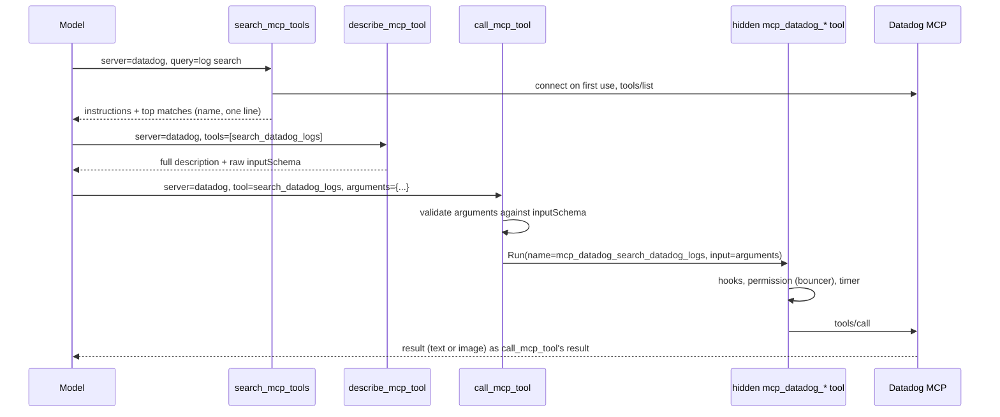

# MCP Tool Catalogue Design Doc

**TL;DR:** A lazy MCP server can opt into catalogue mode (`lazy_mode: "catalogue"`). Its tools then never enter the model's tool list. Instead three fixed tools, `search_mcp_tools`, `describe_mcp_tool` and `call_mcp_tool`, find a tool, return its schema as a tool result and run it. The key decision is that schemas travel in messages rather than the tool list, so the request prefix never changes and the model only pays for the handful of tools it actually uses.

**Problem:** Enabling a lazy MCP adds every one of its tools to every later request. `step_usage` from 2026-10-10 to 2026-10-23 (46k rows, 1,458 sessions) shows how little of that is used:

| Server | Tools per enable | Tokens added | Avg distinct tools called per session |
|---|---|---|---|
| datadog (`toolsets=all`) | 463 | ~413k | 3.2 |
| launchdarkly | 111 | ~59k | 2.2 |
| linear | 77 | ~40k | 2.8 |
| slack | 27 | ~28k | 1.6 |

Steps carrying the Datadog tools were 11.9% of all turn spend ($648 of $5.4k), and those sessions peaked around 760k prompt tokens. Per-tool cost runs 500 to 1,100 tokens, so even a modest server is expensive once enabled. Cache busts from `enable_mcp` are a smaller cost (about $234 of `tools_changed` excess over the period, at the known rate of about one miss per enable). The bigger costs are prompt size, the context window it eats, and compaction pressure. Narrowing Datadog's `toolsets` URL helps Datadog only, and only for the tools picked in advance.

**Goal:** A session that uses a few tools from a catalogue server adds roughly the size of those tools' schemas to its context, not the whole server. Its tool list, and so its cached prefix, stays identical from the first step to the last.

**Scope:**
- In:
  - `lazy_mode` on MCP config.
  - The three catalogue tools and their `.md` descriptions.
  - Connecting a catalogue server on first use.
  - Permissions, the bouncer, hooks, timers and the UI treating a proxied call as the inner MCP tool.
  - Subagents.
  - Docs: `docs/configuration.md`, `GLOSSARY.md`, `AGENTS.md` and an ADR.
- Out:
  - **Picking the mode automatically from a token threshold.** Tokens per tool vary twofold between servers, and `terminal` (8 tools, 60% used) is better loaded whole. Explicit opt-in first, and revisit once there's data on catalogue sessions.
  - **Provider tool search** (Anthropic `defer_loading`, OpenAI `tool_search`). fantasy v0.45.2 has no support, and it only covers some models. The catalogue is the provider-agnostic base that native search could later sit under.
  - **Code mode** (running MCP tools from a script).
  - **Palette changes** beyond showing a server's mode.
  - **Headless `tools/list_changed` refresh,** an existing gap.

**Constraints:**
- **Stable prefix.** The catalogue tools' descriptions and parameters depend only on config: catalogue servers sorted by name, each with its `lazy_description`. Connecting, searching or calling must never change the tool list or the system prompt.
- **Layering** (`AGENTS.md`). The catalogue lives in the `agent` layer, and `internal/agent/tools/mcp` stays unaware of it. Argument validation uses `github.com/google/jsonschema-go`, already a direct dependency.
- **One identity.** Every existing control applies to a proxied call exactly as it does to a directly listed MCP tool, under the same name `mcp_<server>_<tool>`:
  - permission globs,
  - bouncer review,
  - `allowed_mcp`,
  - `enabled_tools` and `disabled_tools`,
  - hooks,
  - the OAuth PascalCase rename.
- **Mutation-friendly code.** New code stays under `gocognit` 30 and survives the mutation check. Search ranking must be deterministic: sort, never range over a map into output.

**Design:**

A catalogue server is a lazy server whose tools are never shown. Its tools are still built per agent by `buildTools`, filtered by `allowed_mcp` and the server's `enabled_tools`/`disabled_tools`, and wrapped like any other tool. They are just kept out of the list `prepareStep` sends. The three catalogue tools read and run from that same hidden set, so every per-agent rule already applied at build time holds without being repeated.



The three tools:

```
search_mcp_tools(server?, query?)       // Ranked matches: name and the description's first sentence; no query lists every name on one server
describe_mcp_tool(server, tools[])      // Full description and raw inputSchema for up to 10 named tools
call_mcp_tool(server, tool, arguments)  // Validates arguments, then runs the hidden tool and returns its result unchanged
```

- **Search.** It ranks by lowercase term overlap, weighting name matches over description matches, with ties broken by name. It returns at most 20 rows.
  - When `server` is given, the result starts with that server's MCP instructions. Catalogue servers' instructions never go in the system prompt (see Decisions).
  - A query with no `server` searches every catalogue server the agent may use.
- **Describe.** It returns `m.tool.InputSchema` as the server sent it. `Tool.Info()` in `mcp-tools.go` keeps only `properties` and `required`, which would lose `$defs`, `oneOf` and `additionalProperties`.
- **Call.** It resolves `tool` within `server` among the agent's hidden tools.
  - **Unknown tool:** the result is an error naming the closest search matches.
  - **Arguments fail the schema:** the result is an error listing the violations, followed by the schema, so a blind call corrects itself in one more step without a separate describe.
  - **Valid arguments:** it runs the hidden tool's wrapper with a synthetic `fantasy.ToolCall` whose `Name` is the inner tool's real name (`Info().Name`, so the OAuth rename holds) and whose `Input` is `arguments`. Permission requests, bouncer review, `PreToolUse` hooks and results therefore see the inner tool.
  - The outer `call_mcp_tool` is not hook-wrapped, so a broad hook fires once per call, not twice.
- **Connecting.** It happens on the first catalogue tool call naming the server, through the same `connectDeferredMCP` path `enable_mcp` uses. Auth expiry returns `enable_mcp`'s non-error "a human must renew it" text.
  - The tool set must be resolved after connecting, so subagents see a server connected mid-run. Today `refreshMCPTools` only updates the orchestrator (`coordinator.go` around line 1368).
- **Hiding tools.** Catalogue tools are filtered out by server name from config, not via the run-start `lazyMCPToolMap` snapshot. `filterLazyMCPTools` lets through tools missing from the snapshot, which would leak a catalogue server's tools into the list after a mid-run connect.
- **Who gets the tools.** The catalogue tools are registered for an agent when at least one catalogue server passes its `allowed_mcp`. `enable_mcp` ignores catalogue servers.
- **Workflows.** A workflow `agent()` that names a specific `mcp_<server>_<tool>` keeps getting it as a direct tool, as `lazyServersFor` does today. Naming a tool is an explicit request for it.
- **Persistence and UI.**
  - History stores the `call_mcp_tool` call as made. Nothing new is persisted, and there's no enabled state to derive, so ADR 0002 is untouched.
  - The chat renders `call_mcp_tool` as the inner MCP tool (server, tool, arguments) through the existing MCP item, and `search` and `describe` as compact generic items.
  - Image results reach the drill-in unchanged (`chat/tool_image.go` keys on the result's MIME type, not the tool name).

**Decisions:**

### Why proxy calls instead of loading individual tools into the list?
**Schemas go in messages, and the tool list never changes.** Anthropic orders the prompt tools, system, messages, so any tool-list change re-writes the whole cached conversation. Loading tools one by one would turn one cache miss per enable into one per new tool. Results in messages are cached like any other turn and survive branching with no derived state.

Declined:
- **Per-tool lazy loading into the list:** a miss on every load.
- **Provider tool search:** not supported by fantasy, and covers only some models.

### Why a mode on lazy servers rather than a new server kind?
**`lazy_mode: "server" | "catalogue"`, defaulting to `"server"`.** A catalogue server needs everything lazy servers already have: a description shown to the model, deferred connect, and exclusion from the tool list and system prompt. A mode keeps `lazy_description` as the one description field, and existing configs behave exactly as today. `lazy_mode` without `lazy_description` is a config error.

### Why three tools, not one?
**Search, describe and call have different costs and permissions.**
- Search and describe read cached metadata and request no permission, like `enable_mcp`.
- Call is a real action, gated as the inner tool.
- Merging describe into search would return schemas for 20 matches when the model wants one.

`describe_mcp_tool` takes a list so related tools cost one step. Names avoid the `mcp_` prefix, which the chat dispatcher (`ui/chat/tools.go`), the bouncer (`bouncer/state.go`) and the permission dialog treat as `mcp_<server>_<tool>`. They follow `list_mcp_resources` instead.

### Why validate arguments in Anvil?
**Without the schema in the tool list, the provider no longer constrains or checks arguments.** Validating against the raw schema turns a server-side error, or a silently wrong call, into a precise message the model can act on. It also lets a call skip describe safely when the schema is already in the conversation.

### Why server instructions in search results, not the system prompt?
**Putting them in the system prompt on connect would change the prefix mid-session.** Search is the entry point, so its result is where the model reads them. A call made without searching first misses them. I accept that, since `describe` and validation errors still carry the schema.

**Risks and Tradeoffs:**
- **Argument quality.** Arguments are no longer decoded against a schema the provider holds. If validation failures exceed about 1 in 10 `call_mcp_tool` calls in real sessions, schema-in-list is doing real work, and per-tool loading or native tool search deserves another look.
- **Extra steps.** A first use costs a search and a describe before the call. Each is a cached step that adds a few thousand tokens at most, against the 28k to 413k per enable above. For a session that uses most of a small server's tools, whole-server mode stays cheaper, which is why the mode is per server.
- **Discovery.** If search misses, the model may conclude a tool doesn't exist. Listing every name on a server is the fallback, and the `search_mcp_tools` description says to use it.
- **Indirection.** Logs, `step_usage` tool counts and `anvil_info` show the catalogue tools, not the inner ones. Permission records and hooks show the inner name.

**Success Criteria:**
- [ ] With Datadog set to `lazy_mode: "catalogue"`, a session that searches, describes and calls two Datadog tools has the same `tools_hash` and `tool_count` on every `step_usage` turn row, and no `tools_changed` miss.
- [ ] In that session, prompt tokens after the first Datadog call exceed those before it by no more than the search, describe and call results.
- [ ] Each of these sees the inner name `mcp_datadog_<tool>` (or `mcp_Datadog_<tool>` under Anthropic OAuth) and the inner arguments for a proxied call:
  - a permission rule `"mcp_datadog_*": "deny"`,
  - a `PreToolUse` hook matching `mcp_datadog_.*`,
  - the bouncer review payload.
  A hook matching `.*` fires once per proxied call.
- [ ] `call_mcp_tool` with arguments that violate the schema returns an error result listing the violation and the schema, and never contacts the server.
- [ ] A tool excluded by `disabled_tools`, or a server outside a subagent's `allowed_mcp`, is absent from search and describe, and `call_mcp_tool` rejects it.
- [ ] A subagent whose first catalogue call connects a deferred server can search and call that server in the same run.
- [ ] A catalogue server's tools never appear in the tool list, including after a mid-run connect or a `tools/list_changed` refresh. `enable_mcp` neither lists nor enables it.
- [ ] Servers without `lazy_mode`, and lazy servers in `"server"` mode, behave exactly as before, and a session using only them sends a byte-identical tool list.
- [ ] An MCP image result returned through `call_mcp_tool` draws in the tool drill-in.

**Context Files:**
- `internal/agent/tools/mcp-tools.go`: the MCP tool wrapper: naming, `Info()` schema stripping, the permission request.
- `internal/agent/tools/mcp/tools.go`: the `allTools` registry, `RunTool` result conversion, `enabled_tools` filtering.
- `internal/agent/tools/enable_mcp.go`: deferred connect and auth-expiry behaviour to reuse.
- `internal/agent/coordinator.go`: `buildToolsWithState`, `connectDeferredMCP`, `refreshMCPTools` (orchestrator-only today).
- `internal/agent/lazy_mcp.go`, `internal/agent/turn.go`: tool filtering per step, and `mcpInstructions`.
- `internal/agent/hooked_tool.go`: hook wrapping, and where to skip `call_mcp_tool`.
- `internal/agent/tools/list_mcp_resources.go`: precedent for a server-addressed meta-tool.
- `internal/agent/bouncer/state.go`, `internal/permission/evaluate.go`: `mcp_` prefix handling and glob matching.
- `internal/agent/workflow_agent.go`: `lazyServersFor` and named-tool restriction.
- `internal/ui/chat/tools.go`, `internal/ui/chat/mcp.go`: tool item dispatch and the MCP item.
- `internal/workflow/schema.go`: precedent for `jsonschema-go` validation.
- `internal/config/config.go`: `MCPConfig.LazyDescription`, `IsLazy`.
- `docs/adr/0002-lazy-mcp-state-from-messages.md`: why enabled state comes from messages. The catalogue needs none.
