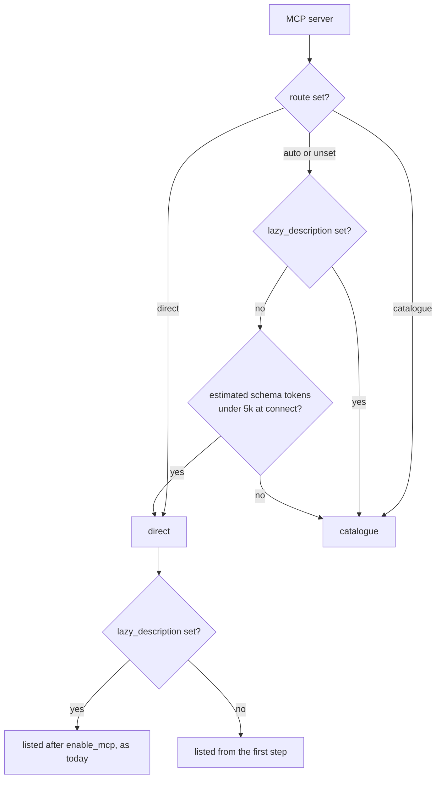
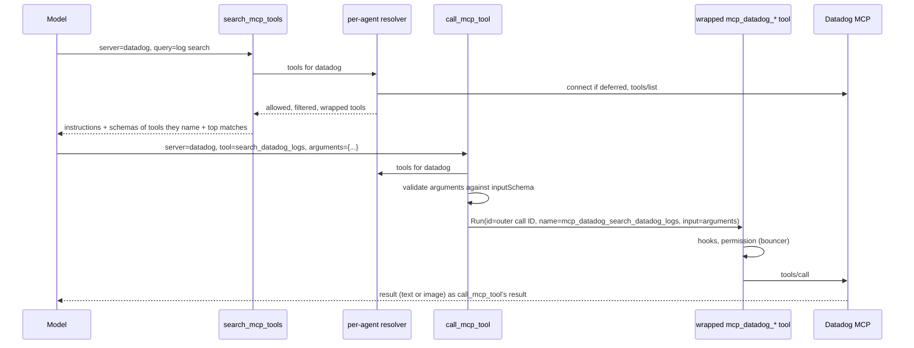

# MCP Tool Catalogue Design Doc

**TL;DR:** MCP tools reach the model through a catalogue by default. Three fixed tools, `search_mcp_tools`, `describe_mcp_tool` and `call_mcp_tool`, find a tool, return its schema as a tool result and run it, so a server's schemas never enter the tool list. Anvil lists a server's tools directly only when they are small enough that listing them costs about as much as finding them. It decides once per connection from the schema size, so nobody has to maintain per-server modes. The spike behind this (`plans/spike-2026-10-23-mcp-catalogue-cost.md`) found that mixing direct and catalogue routes in one session causes no routing mistakes, and that the catalogue costs 41% to 45% less than today's lazy loading.

**Problem:** A server's tools cost tokens on every request once they're listed, and agents use very few of them.
- **Production data:** `step_usage` and `messages` from 2026-10-10 to 2026-10-23 (46k rows, 1,458 sessions) show:
  - An enabled lazy server adds 28k to 413k tokens to every later request.
  - Sessions call an average of 1.6 to 3.2 of each server's 27 to 463 tools.
  - Datadog's schemas alone cost about $335 over the period.
- **After the Datadog narrowing:** its 85 tools still measure about 103k tokens.
- **Why the obvious fixes fall short:**
  - Narrowing `toolsets` and `enabled_tools` allow-lists need someone to predict which tools future tasks need, and keep the list current as tasks and servers change.
  - Today's lazy loading (`enable_mcp`) defers the cost but then pays it on every remaining step of the session, plus a cache miss.

**Goal:** With no per-server configuration, a session pays roughly for the schemas and results of the MCP tools it actually uses. Every tool on every server stays reachable, and the tool list (and so the cached prefix) stays identical from a session's first step to its last.

**Scope:**
- In:
  - A per-server `route` setting (`auto`, `catalogue`, `direct`), defaulting to `auto`, and the size rule `auto` applies.
  - The three catalogue tools and their `.md` descriptions, including schemas for tools a server's instructions name.
  - Connecting a deferred catalogue server on first use, including `mcp.WaitSettled`.
  - Permissions, the bouncer, hooks, timers and the UI treating a proxied call as the inner MCP tool.
  - Subagents and workflow agents.
  - Showing each server's route and the reason for it in `anvil_info` and the MCP palette.
  - Docs: `docs/configuration.md`, `GLOSSARY.md`, `AGENTS.md`, an ADR, and a note that existing lazy servers move to the catalogue by default.
- Out:
  - **Routing from usage history.** Declined (see Decisions). A usage counter can be added later if the size rule puts a server on the wrong side.
  - **Per-agent routes.** The route belongs to the server, and `allowed_mcp` already narrows what each agent sees.
  - **Provider tool search** (Anthropic `defer_loading`, OpenAI `tool_search`). fantasy v0.45.2 has no support, and it only covers some models. The catalogue is the provider-agnostic base that native search could later sit under.
  - **Code mode** (running MCP tools from a script).
  - **Headless `tools/list_changed` refresh,** an existing gap.
  - **The `tools_hash` change after the first step** that the spike found whenever MCP tools are listed (possibly an in-place mutation of shared schema maps). It needs its own issue.

**Constraints:**
- **Stable prefix.** Within a process, the tool list and the catalogue tools' descriptions depend only on config and on route decisions made when each server connected. Searching, calling, connecting a deferred catalogue server, or a runtime palette disable must never change the tool list or the system prompt.
- **Layering** (`AGENTS.md`). The catalogue and the route rule live in the `agent` layer. `internal/agent/tools/mcp` reports schema sizes but knows nothing about routes. Argument validation uses `github.com/google/jsonschema-go`, already a direct dependency.
- **One identity.** Every existing control applies to a proxied call exactly as it does to a directly listed MCP tool, under the same name `mcp_<server>_<tool>`:
  - permission globs,
  - bouncer review,
  - `allowed_mcp`,
  - `enabled_tools` and `disabled_tools`,
  - top-level hooks (hooks never run in subagents, `hooked_tool.go`),
  - the OAuth PascalCase rename.
- **Mutation-friendly code.** New code stays under `gocognit` 30 and survives the mutation check. Search ranking and every server list must be deterministic: sort, never range over a map into output. Pin the size threshold's boundary in tests.

**Design:**

**Choosing a route.** Each server resolves to `direct` or `catalogue` once per connection:



- **The estimate** is the byte length of the server's `tools/list` JSON (names, descriptions, schemas) divided by 2.8. The spike measured 0.33 to 0.38 tokens per byte across Datadog, LaunchDarkly, Linear and Slack, so the estimate errs high.
  - Among non-lazy servers, the 5k threshold would put muninn (~3.9k) and terminal (~2.3k) in `direct`, and every large server in the catalogue.
  - It's a constant, not a setting: `route` is the override.
- **Lazy servers go to the catalogue under `auto`.** They aren't connected at startup, so there's no size to measure, and marking a server lazy already says it's large or rarely used. That's a deliberate behaviour change for existing lazy servers.
  - `route: "direct"` on a lazy server keeps today's `enable_mcp` flow, and ADR 0002 still governs it.
- **The decision is recorded on the server's state** (route plus reason, for example "auto: ~3.9k tokens, under 5k") when it connects. It's kept until the server reconnects, which already rebuilds the tool list.
  - A `tools/list_changed` that grows a direct server past the threshold doesn't flip it mid-process.
  - `anvil_info` and the palette show the route and the reason.
- **Why size alone is enough:** listing a server directly costs its schema tokens `T` on every step, and routing it through the catalogue costs about two extra steps in the sessions that use it, with probability `p`.
  - At this user's averages (99 steps and 206k prompt tokens per session), direct listing is cheaper only when `T < p × ~4.2k` tokens.
  - Large servers are 10 to 200 times past that line whatever their usage, and near the line either choice costs within about $0.10 a session.
  - So usage history would refine a decision whose stake is small (see Decisions).

**Catalogue servers are never built into any agent's tool list.** Nothing has to filter them out afterwards, so no name snapshot can go stale. The catalogue tools build them instead: each call goes through a per-agent resolver that builds the agent's MCP tools for one server on demand.



The three tools:

```
search_mcp_tools(server?, query?)       // Ranked matches (name, the description's first sentence); with server and no query, every name on it
describe_mcp_tool(server, tools[])      // Full description and raw inputSchema for up to 10 named tools
call_mcp_tool(server, tool, arguments)  // Validates arguments, then runs the tool and returns its result unchanged
```

- **Descriptions.**
  - The catalogue tools' descriptions list the catalogue servers the agent's `allowed_mcp` permits, sorted by name, each with its `lazy_description`. A server without one falls back to its `serverInfo` title and name.
  - They state that these servers' tools "are never callable directly by name". With that wording, the spike's 96 catalogue and mixed runs produced no routing mistakes.
- **The resolver.** The MCP half of `buildToolsWithState` (`coordinator.go`, the `GetMCPTools` loop with its `allowed_mcp` check, hook and error-result wrapping) becomes one helper. Building the tool list and the resolver both use it, so the rules can't drift apart.
  - **Tool list mode:** the helper skips tools of catalogue-routed servers, judged by the server's recorded route via the unwrapped tool (`Tool.MCP()`). The one exception is inner tool names a workflow `agent()` passes in explicitly. `buildWorkflowAgent` still connects a deferred server through `lazyServersFor`.
  - **Resolver mode:** it returns the server's tools, and keys them by `Tool.MCP()`, never by parsing `mcp_<server>_` out of a name. Server names can contain `_`, and the OAuth rename changes case.
  - **Connecting:** the resolver connects a deferred server with `toolsmcp.ConnectDeferred` before building, so the search that connects a server already sees its tools. It skips `refreshMCPTools`, which would rebuild the orchestrator's list for tools that are never listed, and which fails in a session with no orchestrator. That also makes it work the same in subagents.
  - **Connection states:** it follows `enable_mcp`'s handling one state at a time (`enable_mcp.go`), except for a server that is still starting.
    - Auth expiry returns `enable_mcp`'s non-error "a human must renew it" text.
    - A server that is disabled or in error returns a non-error message saying so, never an empty match list that reads as "no such tools".
    - A server that is still connecting makes later callers wait for it to settle, bounded by the server's timeout.
      - The race is between agents (the orchestrator, concurrent subagents, parallel workflow `agent()` calls or a palette enable), not within one step. fantasy runs tools one at a time unless `Info().Parallel` is set, and the catalogue tools stay sequential.
      - `internal/agent/tools/mcp` gains a generic `WaitSettled(ctx, name)` that returns once the server leaves `StateStarting`. It re-checks state after subscribing, so a transition isn't missed.
- **Search.**
  - **Ranking:** lowercase term overlap, with name matches weighted over description matches and ties broken by name.
  - **Result size:** a query returns at most 20 rows. `server` with no query lists every name on that server, uncapped, which is the fallback when a search misses.
  - **With `server`:** the result starts with that server's MCP instructions, followed by the full schemas of up to 3 tools whose exact names appear in them.
    - In the spike, 42 of 44 invalid-argument errors were Datadog's `load_datadog_skill` and `list_datadog_skills`, which its instructions say to call "before invoking other tools". Agents called them blind and missed their required `telemetry` field.
  - **Without `server`:** search covers only servers that are already connected and matches the descriptions of the rest, so one vague query never connects (or prompts OAuth for) every catalogue server. Connection state is per process, so another session's connect can widen these results, which changes only a tool result, never the prefix.
- **Tool names.** Search returns the raw MCP tool name (`search_datadog_logs`). Describe and call take that name, and also accept the full `mcp_<server>_<tool>` form in any case, since models echo whatever they last saw.
- **Describe.** It returns the server's input schema as sent, through a new `InputSchema()` accessor on `tools.Tool`. `Tool.Info()` in `mcp-tools.go` keeps only `properties` and `required`.
- **Call.**
  - **Unknown tool:** an error naming the closest search matches.
  - **Schema violation:** an error listing the violations and then the schema, with a fixed prefix so the rate can be counted from `messages`. The server is never contacted.
  - **Unresolvable schema** (one that won't unmarshal into `jsonschema.Schema`, or has a remote `$ref` that `jsonschema-go` can't load): the call passes through unvalidated, and a debug log records it.
  - **Valid call:** it runs the wrapped tool with a `fantasy.ToolCall` carrying the outer call's `ID`, the inner tool's real name (`Info().Name`) and `arguments` as `Input`.
    - The permission prompt observer, hook approvals and the UI's awaiting-permission state all key on the call ID, so they and the outer `timedTool` behave as for a direct call.
    - The outer `call_mcp_tool` is not hook-wrapped, so a broad hook fires once per call, and a hook matching `call_mcp_tool` itself never fires. Hooks target the inner name.
- **Arguments.**
  - `arguments` is declared with no `type`, and accepts a JSON object or a string holding one, since models often send nested objects as strings.
  - A property-less `{"type": "object"}` is what Gemini tends to reject (fantasy maps it to an OBJECT with no properties). An untyped parameter maps to a string there and stays untyped on Anthropic and OpenAI.
  - Validation runs before the inner tool's hooks, so input a hook rewrites is not re-validated, the same as for a direct MCP call today.
- **Who gets the catalogue tools.** They are registered for an agent when at least one catalogue-routed server passes its `allowed_mcp`, the same gate MCP tools pass today.
  - **Not `allowsTool`:** an agent whose `tools:` lists only built-ins (the documented explorer with `tools: [glob, grep, ls, view]` and `mcps: muninn:`) keeps its MCP access.
  - **How to remove them:**
    - Globally, through `options.disabled_tools`.
    - Per agent, leave the servers out of `mcps:`, or, in an agent whose `tools:` is a negative list, add `!call_mcp_tool` (and the other two).
    - A `!name` entry in a positive list is invalid: `ValidateFilterList` rejects mixed lists, and the fallback then allows every built-in, so the docs must not suggest it there.
- **Lazy state stays out of it.** These skip catalogue-routed servers unconditionally, whatever the derived lazy state says:
  - `enable_mcp`,
  - `reconnectDeferredServers`,
  - `mcpInstructions`, which gains the catalogue server names as an input. The one exception is a workflow agent that names a server's tools directly: it gets that server's instructions, since it never searches,
  - the palette's lazy toggle.

  So a session that enabled Datadog before the change, or an old `MCPToggleContent`, never brings back its tools or instructions.
- **Persistence and UI.**
  - History stores the `call_mcp_tool` call as made. Nothing new is persisted, so ADR 0002 is untouched.
  - The chat renders `call_mcp_tool` as the inner MCP tool (server, tool, arguments) through the existing MCP item, and `options.expanded_tools` patterns match the inner name.
  - `search` and `describe` render as compact generic items.
  - Image results reach the drill-in unchanged (`chat/tool_image.go` keys on the result's MIME type, not the tool name).

**Decisions:**

### Which servers go through the catalogue?
**All of them, except servers whose schemas are under about 5k tokens, decided by Anvil from the schema size at connect time.** In the spike, routing every server through the catalogue was the cheapest arm on both models. The only thing direct listing bought was latency on small servers: muninn alone took 2 steps instead of 4, 7.7 s instead of 12.8 s, at the same cost.

| Option | Pros | Cons | Verdict |
|---|---|---|---|
| Catalogue for everything | Simplest, and cheapest in tokens | About 2 extra steps (~5 s) whenever a small server is first used | Close second |
| Size rule, decided by Anvil | Same token cost, and small servers keep their speed. No upkeep | A threshold to justify, and route depends on server size | **Yes** |
| Per-server modes set by hand | Full control | Needs upkeep nobody will do. That's what `route` overrides are for | Override only |
| Routing from usage history | Tracks the break-even per server | Reads history at runtime (a new table, and a change to `step_usage` being observation-only), hidden flips between sessions, feedback loops, per-repo and per-agent bias. All to tune servers whose stake is about $0.10 a session | No |
| `enabled_tools` allow-lists | No code | Predicts future tasks and needs curating, and hides tools silently | No |

### Is it safe to mix direct and catalogue routes in one session?
**Yes.** Across 96 catalogue and mixed runs on Opus and Sonnet:
- no agent called a catalogue tool by its direct name,
- none sent a listed server's tool through `call_mcp_tool`,
- all answered correctly.

Agents switched routes within a single task (`mcp_Muninn_grep`, then `search_mcp_tools`, then `call_mcp_tool`).

### Why proxy calls instead of loading individual tools into the list?
**Schemas go in messages, and the tool list never changes.** Anthropic orders the prompt tools, system, messages, so any tool-list change re-writes the whole cached conversation. In the spike, lazy loading's mid-session enable more than doubled cache writes (69k against 31k per task). Results in messages are cached like any other turn and survive branching with no derived state.

Declined:
- **Per-tool lazy loading into the list:** a miss on every load.
- **Provider tool search:** not supported by fantasy, and covers only some models.

### What happens to `enable_mcp`?
**It stays for lazy servers explicitly routed `direct`, and is otherwise unused.** Removing it would break anyone who prefers whole-server loading, and keeping it costs nothing, since it only appears when such a server exists.

### Why three tools, not one?
**Search, describe and call have different costs and permissions.**
- Search and describe read server metadata and request no permission, like `enable_mcp`.
- Call is a real action, gated as the inner tool.
- Merging describe into search would return schemas for 20 matches when the model wants one.

`describe_mcp_tool` takes a list so related tools cost one step. The names avoid the `mcp_` prefix, which the chat dispatcher (`ui/chat/tools.go`), the bouncer (`internal/bouncer/state.go`) and the permission dialog read as `mcp_<server>_<tool>`. They follow `list_mcp_resources` instead.

### Why validate arguments in Anvil?
**The model now writes arguments from a schema it read in a tool result, and a precise error before the call costs one step.** Providers never enforced MCP schemas (fantasy sends tools with `Strict: false`, and `Info()` strips `$defs` and `oneOf`), so this check is new. In the spike, genuine schema mistakes were 2 in 269 calls (0.7%), and every run still finished correctly. Two cases soften the strictness:
- An unresolvable schema passes calls through.
- A server whose schema rejects calls it would accept can be routed `direct`.

### Why server instructions in search results, not the system prompt?
**Putting them in the system prompt on connect would change the prefix mid-session.** Search is the entry point, so its result carries them, along with the schemas of the tools they name. A call made without searching first never sees them, but describe and validation errors still carry the schema.

### What does a restricted workflow agent reach through `call_mcp_tool`?
**Every tool on the catalogue servers its `allowed_mcp` permits.** Naming `call_mcp_tool` in `agent({tools})` is an explicit grant, like naming `bash`. A workflow wanting a narrower surface names the inner tools directly, which keeps them listed.

**Risks and Tradeoffs:**
- **More steps.** On Opus, the catalogue took 6.8 steps per task against 3.9 for lazy loading, and 26.2 s mean (21.1 s median) against 19.3 s (18.1 s). That's the price of the cost saving, and the main thing to watch after release.
  - In real sessions the cost side improves further: enabling Datadog halfway through a 99-step session costs about $3.20 in re-read schemas, against about $0.30 for the catalogue's extra steps.
- **A wrong threshold.** The 5k-token line comes from one user's session averages and one tokenizer. If a heavily used server lands just above it, latency suffers, and if a rarely used one lands below, its schemas ride on every step. Either way the loss is bounded by the server's size, and `route` overrides it. If it proves wrong in practice, a per-server usage counter can nudge the threshold.
- **Behaviour change for lazy servers.** Existing lazy servers move from `enable_mcp` to the catalogue under `auto`. Release notes and `docs/configuration.md` say how to keep the old flow (`route: "direct"`).
- **Argument quality.** Schema-violation errors carry a fixed prefix and are counted from `messages`. If those not caused by instruction-named tools exceed about 1 in 10 `call_mcp_tool` calls, reading schemas from results isn't working.
- **Discovery.** If search misses, the model may conclude a tool doesn't exist. Listing every name on a server is the fallback, and the `search_mcp_tools` description says to use it. The spike's tasks were easy, so discovery among many similar tools is untested.
- **Indirection.** Logs, `step_usage` tool counts and `anvil_info` tool counts show the catalogue tools, not the inner ones. Permission records and hooks show the inner name.

**Success Criteria:**
- [ ] With today's config unchanged (muninn eager, every other server lazy), `anvil_info` shows muninn as `direct` with its estimated tokens under 5k, and every other server, terminal included, as `catalogue` (lazy). Setting `route` on a server overrides that.
- [ ] A non-lazy server whose `tools/list` estimates at 5,000 tokens or more is routed to the catalogue, and one at 4,999 or less is listed directly.
- [ ] A session that searches, describes and calls two Datadog tools has the same `tools_hash` and `tool_count` on every `step_usage` turn row, and no `tools_changed` miss.
- [ ] `search_mcp_tools(server=datadog)` returns Datadog's instructions followed by the schemas of `load_datadog_skill` and `list_datadog_skills`. Rerunning the spike harness (`plans/spike-data/run.py` on branch `spike/mcp-catalogue-cost`, adapted to the built feature) produces no invalid-argument errors on those two tools.
- [ ] The first `search_mcp_tools(server=datadog)` in a session connects the deferred server and returns its matches in the same result, in both the orchestrator and a subagent. Two concurrent subagents whose first search hits the same deferred server both return matches.
- [ ] An agent with `tools: [glob, grep, ls, view]` and `mcps: {datadog: []}` can search and call Datadog tools. An agent with `tools: ["!call_mcp_tool", "!search_mcp_tools", "!describe_mcp_tool"]` gets none of the three and keeps every other built-in.
- [ ] Searching a server that is in error or disabled returns a message saying so, not an empty match list.
- [ ] `call_mcp_tool` succeeds on an Anthropic, an OpenAI and a Gemini model, with `arguments` sent as an object and as a JSON string.
- [ ] Each of these sees the inner name `mcp_datadog_<tool>` (or `mcp_Datadog_<tool>` under Anthropic OAuth) and the inner arguments for a proxied call:
  - a permission rule `"mcp_datadog_*": "deny"`,
  - the bouncer review payload,
  - in the top-level agent, a `PreToolUse` hook matching `mcp_datadog_.*`.

  A hook matching `.*` fires once per proxied call.
- [ ] A proxied call that waits on a permission prompt shows the chat's awaiting-permission state, and its timer restarts when the prompt is granted.
- [ ] `call_mcp_tool` with arguments that violate the schema returns an error result listing the violation and the schema, and never contacts the server.
- [ ] A tool excluded by `disabled_tools`, or a server outside a subagent's `allowed_mcp`, is absent from search and describe, and `call_mcp_tool` rejects it.
- [ ] `search_mcp_tools` without `server` connects no deferred server.
- [ ] A catalogue-routed server's tools never appear in the tool list, including after a mid-run connect, a `tools/list_changed` refresh, or a session that enabled the server through `enable_mcp` or the palette before the change. Its instructions never appear in the system prompt.
- [ ] A lazy server with `route: "direct"` behaves exactly as lazy servers do today (`enable_mcp`, palette toggle, ADR 0002 state).
- [ ] A workflow `agent()` naming `mcp_datadog_<tool>` gets that tool as a direct tool.
- [ ] With every server routed `direct`, the tool list and system prompt are byte-identical to today's.
- [ ] An MCP image result returned through `call_mcp_tool` draws in the tool drill-in.

**Context Files:**
- `plans/spike-2026-10-23-mcp-catalogue-cost.md`: the measurements behind the route rule, the mixing finding and the instruction-named schemas. The harness and prototype are on branch `spike/mcp-catalogue-cost` (`internal/agent/tools/spike_catalogue.go` is a working starting point).
- `internal/agent/tools/mcp-tools.go`: the MCP tool wrapper (naming, `MCP()`, `Info()` schema stripping, the permission request).
- `internal/agent/tools/mcp/tools.go`, `internal/agent/tools/mcp/init.go`:
  - the `allTools` registry and `RunTool` result conversion,
  - `enabled_tools` filtering,
  - `ClientInfo` (where the route and estimate are recorded),
  - `ConnectDeferred` and `InitializeSingle`,
  - where `WaitSettled` goes.
- `internal/agent/coordinator.go`:
  - `buildToolsWithState`, whose MCP half becomes the shared helper,
  - `connectDeferredMCP`,
  - `refreshMCPTools` (orchestrator only),
  - where `enable_mcp` bypasses `allowsTool`.
- `internal/agent/tools/enable_mcp.go`: deferred connect and auth-expiry behaviour to reuse.
- `internal/config/config.go`, `internal/config/filter.go`, `internal/agent/tool_access.go`: `MCPConfig` (`LazyDescription`, `EnabledTools`, the new `Route`), filter-list validation and its allow-all fallback.
- `internal/agent/lazy_mcp.go`: `deriveLazyMCPState`, `filterLazyMCPTools`, `reconnectDeferredServers`, `mcpInstructions`.
- `internal/agent/turn.go`, `internal/permission/permission.go`: `timedTool`, the prompt observer and hook approval keyed on call ID.
- `internal/agent/hooked_tool.go`: hook wrapping (top-level only), and where to skip `call_mcp_tool`.
- `internal/agent/workflow_agent.go`: `lazyServersFor` and named-tool restriction.
- `internal/agent/tools/anvil_info.go`, `internal/ui/dialog/mcp_palette.go`: where route and reason are shown, and the lazy toggle.
- `internal/agent/tools/list_mcp_resources.go`: precedent for a server-addressed meta-tool.
- `internal/bouncer/state.go`, `internal/permission/evaluate.go`: `mcp_` prefix handling and glob matching.
- `internal/ui/chat/tools.go`, `internal/ui/chat/mcp.go`: tool item dispatch and the MCP item.
- `internal/workflow/schema.go`: precedent for `jsonschema-go` validation.
- `docs/adr/0002-lazy-mcp-state-from-messages.md`: why enabled state comes from messages. It still governs lazy servers routed `direct`, and the catalogue needs none.
