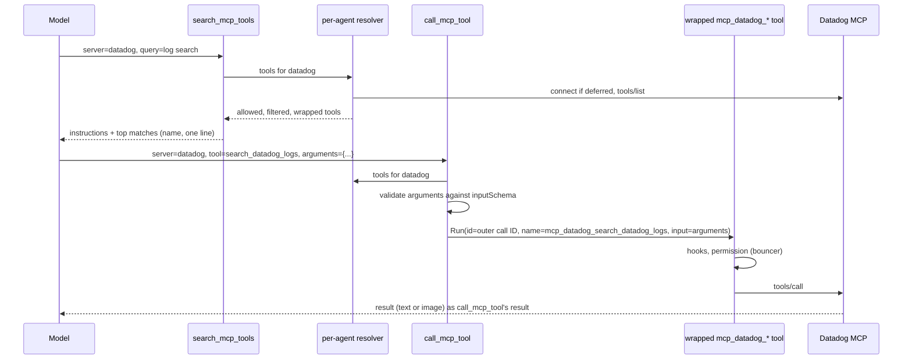

# MCP Tool Catalogue Design Doc

**TL;DR:** A lazy MCP server can opt into catalogue mode (`lazy_mode: "catalogue"`). Its tools then never enter the model's tool list. Instead three fixed tools, `search_mcp_tools`, `describe_mcp_tool` and `call_mcp_tool`, find a tool, return its schema as a tool result and run it. The key decision is that schemas travel in messages rather than the tool list, so the request prefix never changes and the model pays only for the handful of tools it actually uses, without anyone having to predict which ones those are.

**Problem:** Enabling a lazy MCP adds every one of its tools to every later request. `step_usage` and `messages` from 2026-10-10 to 2026-10-23 (46k rows, 1,458 sessions) show how little of that is used:

| Server | Tools per enable | Tokens added | Distinct tools called, per session avg | Distinct tools called, union over all sessions |
|---|---|---|---|---|
| datadog (`toolsets=all`) | 463 | ~413k | 3.2 | 17 |
| launchdarkly | 111 | ~59k | 2.2 | 12 |
| linear | 77 | ~40k | 2.8 | 12 |
| slack | 27 | ~28k | 1.6 | 9 |

Weighting each step by the share of its prompt that was tool schemas, Datadog's schemas cost about $335 over the period and the other lazy servers about $164 (roughly 3% of $5.4k turn spend). Datadog sessions also peaked around 760k prompt tokens. Since then the Datadog URL has been narrowed to fewer toolsets, which cuts its share but fixes the tool choice in advance.

The cheaper fix is an `enabled_tools` allow-list of the observed union, which already exists (`MCPConfig.EnabledTools`, applied in `mcp/tools.go`). It would cut most of the remaining cost with no code. Its limit is the one this design removes: the model can only use tools someone predicted, a task needing a tool outside the list fails silently (the model never learns the tool exists), and each server's list needs curating as tasks and servers change. Catalogue mode trades a few extra steps on first use for access to the whole server at roughly allow-list cost.

**Goal:** A session that uses a few tools from a catalogue server grows its context by roughly those tools' schemas and results, not the whole server, while every tool on the server stays reachable. Its tool list, and so its cached prefix, stays identical from the first step to the last.

**Scope:**
- In:
  - `lazy_mode` on MCP config, including the regenerated JSON schema.
  - The three catalogue tools and their `.md` descriptions.
  - Connecting a catalogue server on first use.
  - Permissions, the bouncer, hooks, timers and the UI treating a proxied call as the inner MCP tool.
  - Subagents and workflow agents.
  - Excluding catalogue servers from lazy-enable state and the palette toggle.
  - Docs: `docs/configuration.md`, `GLOSSARY.md`, `AGENTS.md` and an ADR.
- Out:
  - **Picking the mode automatically from a token threshold.** Tokens per tool vary twofold between servers, and `terminal` (8 tools, 60% used) is better loaded whole. Explicit opt-in first, and revisit once there's data on catalogue sessions.
  - **Provider tool search** (Anthropic `defer_loading`, OpenAI `tool_search`). fantasy v0.45.2 has no support, and it only covers some models. The catalogue is the provider-agnostic base that native search could later sit under.
  - **Code mode** (running MCP tools from a script).
  - **Headless `tools/list_changed` refresh,** an existing gap.

**Constraints:**
- **Stable prefix.** The catalogue tools' descriptions and parameters depend only on config: catalogue servers sorted by name, each with its `lazy_description`. Connecting, searching or calling must never change the tool list or the system prompt.
- **Layering** (`AGENTS.md`). The catalogue lives in the `agent` layer, and `internal/agent/tools/mcp` stays unaware of it. Argument validation uses `github.com/google/jsonschema-go`, already a direct dependency.
- **One identity.** Every existing control applies to a proxied call exactly as it does to a directly listed MCP tool, under the same name `mcp_<server>_<tool>`:
  - permission globs,
  - bouncer review,
  - `allowed_mcp`,
  - `enabled_tools` and `disabled_tools`,
  - top-level hooks (hooks never run in subagents, `hooked_tool.go`),
  - the OAuth PascalCase rename.
- **Mutation-friendly code.** New code stays under `gocognit` 30 and survives the mutation check. Search ranking must be deterministic: sort, never range over a map into output.

**Design:**

A catalogue server is a lazy server whose tools are never put in the tool list. The catalogue tools don't hold a snapshot of those tools. Each call goes through a per-agent resolver, which builds the agent's MCP tools for one server on demand.



The three tools:

```
search_mcp_tools(server?, query?)       // Ranked matches (name, the description's first sentence); with server and no query, every name on it
describe_mcp_tool(server, tools[])      // Full description and raw inputSchema for up to 10 named tools
call_mcp_tool(server, tool, arguments)  // Validates arguments, then runs the tool and returns its result unchanged
```

- **The resolver.** The MCP half of `buildToolsWithState` (`coordinator.go`, the `GetMCPTools` loop with its `allowed_mcp` check, hook and error-result wrapping) becomes one helper. Building the tool list and the resolver both use it, so the rules can't drift apart.
  - The resolver connects a deferred server through `connectDeferredMCP` before building, so the search that connects a server already sees its tools.
  - It works the same in subagents, since it doesn't depend on `refreshMCPTools`, which updates only the orchestrator.
  - It keys tools by the server name on the unwrapped MCP tool (`Tool.MCP()`), never by parsing `mcp_<server>_` out of a name. Server names can contain `_`, and the OAuth rename changes case.
  - Auth expiry returns `enable_mcp`'s non-error "a human must renew it" text.
- **Search.**
  - **Ranking:** lowercase term overlap, with name matches weighted over description matches and ties broken by name.
  - **Result size:** a query returns at most 20 rows. `server` with no query lists every name on that server, uncapped. That listing is the fallback when a search misses.
  - **Instructions:** when `server` is given, the result starts with that server's MCP instructions.
  - **Without `server`:** search covers only servers that are already connected and matches the `lazy_description` of the rest, so one vague query never connects (or prompts OAuth for) every catalogue server.
- **Describe.** It returns `m.tool.InputSchema` as the server sent it. `Tool.Info()` in `mcp-tools.go` keeps only `properties` and `required`.
- **Call.**
  - **Unknown tool:** an error naming the closest search matches.
  - **Schema violation:** an error listing the violations and then the schema, with a fixed prefix so the rate can be counted from `messages`. The server is never contacted.
  - **Unresolvable schema** (for example a remote `$ref`, which `jsonschema-go` can't load): the call passes through unvalidated, and a debug log records it.
  - **Valid call:** it runs the wrapped tool with a `fantasy.ToolCall` carrying the outer call's `ID`, the inner tool's real name (`Info().Name`) and `arguments` as `Input`.
    - The permission prompt observer, hook approvals and the UI's awaiting-permission state all key on the call ID, so they and the outer `timedTool` behave as for a direct call.
    - The outer `call_mcp_tool` is not hook-wrapped, so a broad hook fires once per call.
- **Hiding tools.** Every agent keeps a set of hidden tool names: the tools of catalogue servers, minus any a workflow `agent()` names explicitly.
  - `prepareStep` filters on that set rather than via the run-start `lazyMCPToolMap` snapshot, so a mid-run connect or `tools/list_changed` refresh can't leak tools into the list.
  - A workflow that names `mcp_datadog_x` keeps it as a direct tool, as `lazyServersFor` does today.
- **Who gets the catalogue tools.** They are registered for an agent when at least one catalogue server passes its `allowed_mcp`. Unlike `enable_mcp`, they then go through `allowsTool`, so `allowed_tools` and `disabled_tools` can remove them.
- **Lazy state stays out of it.** Catalogue servers are skipped by:
  - `enable_mcp`,
  - `deriveLazyMCPState`'s effects (`reconnectDeferredServers`, `mcpInstructions`),
  - the palette's lazy toggle.

  So a session that enabled Datadog before it became a catalogue server, or an old `MCPToggleContent`, never brings back its tools or instructions. The palette shows catalogue servers with their mode and connection state, without a lazy toggle.
- **Persistence and UI.**
  - History stores the `call_mcp_tool` call as made. Nothing new is persisted, so ADR 0002 is untouched.
  - The chat renders `call_mcp_tool` as the inner MCP tool (server, tool, arguments) through the existing MCP item. `options.expanded_tools` patterns match the inner name.
  - `search` and `describe` render as compact generic items.
  - Image results reach the drill-in unchanged (`chat/tool_image.go` keys on the result's MIME type, not the tool name).

**Decisions:**

### Why a catalogue rather than an `enabled_tools` allow-list?
**Both, for different servers.** An allow-list of the observed union is the right call for a server whose use is narrow and stable, and it costs nothing to build. Catalogue mode is for servers where the useful subset varies by task (Datadog's 17-tool union came from 3.2 per session, spread across toolsets). There, an allow-list either grows back towards the whole server or silently hides the tool a new task needs. If, after the Datadog narrowing, allow-lists bring the remaining schema cost under about $20 a week and nobody hits a missing tool, this design isn't worth building yet. Measure that first (see Risks).

### Why proxy calls instead of loading individual tools into the list?
**Schemas go in messages, and the tool list never changes.** Anthropic orders the prompt tools, system, messages, so any tool-list change re-writes the whole cached conversation. Loading tools one by one would turn one cache miss per enable into one per new tool. Results in messages are cached like any other turn and survive branching with no derived state.

Declined:
- **Per-tool lazy loading into the list:** a miss on every load.
- **Provider tool search:** not supported by fantasy, and covers only some models.

### Why a mode on lazy servers rather than a new server kind?
**`lazy_mode: "server" | "catalogue"`, defaulting to `"server"`.** A catalogue server needs what lazy servers already have: a description shown to the model, deferred connect, and exclusion from the tool list and system prompt. A mode keeps `lazy_description` as the one description field, and existing configs behave exactly as today. `lazy_mode` without `lazy_description` is a config error.

### Why three tools, not one?
**Search, describe and call have different costs and permissions.**
- Search and describe read server metadata and request no permission, like `enable_mcp`.
- Call is a real action, gated as the inner tool.
- Merging describe into search would return schemas for 20 matches when the model wants one.

`describe_mcp_tool` takes a list so related tools cost one step. The names avoid the `mcp_` prefix, which the chat dispatcher (`ui/chat/tools.go`), the bouncer (`internal/bouncer/state.go`) and the permission dialog read as `mcp_<server>_<tool>`. They follow `list_mcp_resources` instead.

### Why validate arguments in Anvil?
**It's a new check, kept because the model now writes arguments from a schema it read in a tool result.** Providers never enforced MCP schemas (fantasy sends tools with `Strict: false`, and `Info()` strips `$defs` and `oneOf`). So this is stricter than today, not a replacement. A precise error before the call costs one step, while a wrong call to a lenient server can do the wrong thing. Two cases soften the strictness:
- An unresolvable schema passes calls through.
- A server whose schema rejects calls it would accept can stay in `"server"` mode.

### What does a restricted workflow agent reach through `call_mcp_tool`?
**Every tool on the catalogue servers its `allowed_mcp` permits.** Naming `call_mcp_tool` in `agent({tools})` is an explicit grant, like naming `bash`. A workflow wanting a narrower surface names the inner tools directly, which keeps them listed.

### Why server instructions in search results, not the system prompt?
**Putting them in the system prompt on connect would change the prefix mid-session.** Search is the entry point, so its result is where the model reads them. Two costs are accepted:
- They repeat on each search that names the server. That's fine for today's servers, whose instructions are short.
- A call made without searching first never sees them, but `describe` and validation errors still carry the schema.

**Risks and Tradeoffs:**
- **Not worth building yet.** Allow-lists may close most of the gap. Before building, set `enabled_tools` to the observed union on LaunchDarkly, Linear and Slack, and leave Datadog narrowed, for a week. Then re-run the schema-share query and count sessions where the model wanted a tool it couldn't see.
- **Argument quality.** Schema-violation errors carry a fixed prefix and are counted from `messages`. If they exceed about 1 in 10 `call_mcp_tool` calls, reading schemas from results isn't working, and per-tool loading or native tool search deserves another look.
- **Extra steps.** A first use costs a search and a describe before the call. Each step re-reads the whole cached prompt (sessions using lazy servers average about 215k prompt tokens), so three extra steps cost about $0.15 against about $2.25 of schema saved per session, plus a few seconds of latency each. Compaction can drop earlier describe results, which costs another describe after a summary. For a session that uses most of a small server's tools, whole-server mode stays cheaper, which is why the mode is per server.
- **Discovery.** If search misses, the model may conclude a tool doesn't exist. Listing every name on a server is the fallback, and the `search_mcp_tools` description says to use it.
- **Indirection.** Logs, `step_usage` tool counts and `anvil_info` show the catalogue tools, not the inner ones. Permission records and hooks show the inner name.

**Success Criteria:**
- [ ] With Datadog set to `lazy_mode: "catalogue"`, a session that searches, describes and calls two Datadog tools has the same `tools_hash` and `tool_count` on every `step_usage` turn row, and no `tools_changed` miss.
- [ ] The first `search_mcp_tools(server=datadog)` in a session connects the deferred server and returns its matches in the same result, in both the orchestrator and a subagent.
- [ ] The same scripted Datadog task, run in `"server"` mode, with an `enabled_tools` allow-list and in catalogue mode, is recorded with total prompt tokens, list cost and step count for each. Catalogue mode uses fewer prompt tokens than `"server"` mode.
- [ ] Each of these sees the inner name `mcp_datadog_<tool>` (or `mcp_Datadog_<tool>` under Anthropic OAuth) and the inner arguments for a proxied call:
  - a permission rule `"mcp_datadog_*": "deny"`,
  - the bouncer review payload,
  - in the top-level agent, a `PreToolUse` hook matching `mcp_datadog_.*`.

  A hook matching `.*` fires once per proxied call.
- [ ] A proxied call that waits on a permission prompt shows the chat's awaiting-permission state, and its timer restarts when the prompt is granted.
- [ ] `call_mcp_tool` with arguments that violate the schema returns an error result listing the violation and the schema, and never contacts the server.
- [ ] A tool excluded by `disabled_tools`, or a server outside a subagent's `allowed_mcp`, is absent from search and describe, and `call_mcp_tool` rejects it.
- [ ] `search_mcp_tools` without `server` connects no deferred server.
- [ ] A catalogue server's tools never appear in the tool list, including after a mid-run connect, a `tools/list_changed` refresh, or a session that enabled the server through `enable_mcp` or the palette before it became a catalogue server. Its instructions never appear in the system prompt.
- [ ] A workflow `agent()` naming `mcp_datadog_<tool>` gets that tool as a direct tool.
- [ ] With no catalogue server configured, the tool list and system prompt are byte-identical to today's.
- [ ] An MCP image result returned through `call_mcp_tool` draws in the tool drill-in.

**Context Files:**
- `internal/agent/tools/mcp-tools.go`: the MCP tool wrapper (naming, `MCP()`, `Info()` schema stripping, the permission request).
- `internal/agent/tools/mcp/tools.go`: the `allTools` registry, `RunTool` result conversion, `enabled_tools` filtering.
- `internal/agent/coordinator.go`:
  - `buildToolsWithState`, whose MCP half becomes the shared helper,
  - `connectDeferredMCP`,
  - `refreshMCPTools` (orchestrator only),
  - where `enable_mcp` bypasses `allowsTool`.
- `internal/agent/tools/enable_mcp.go`: deferred connect and auth-expiry behaviour to reuse.
- `internal/agent/lazy_mcp.go`: `deriveLazyMCPState`, `filterLazyMCPTools`, `reconnectDeferredServers`, `mcpInstructions`.
- `internal/agent/turn.go`, `internal/permission/permission.go`: `timedTool`, the prompt observer and hook approval keyed on call ID.
- `internal/agent/hooked_tool.go`: hook wrapping (top-level only), and where to skip `call_mcp_tool`.
- `internal/agent/workflow_agent.go`: `lazyServersFor` and named-tool restriction.
- `internal/agent/tools/list_mcp_resources.go`: precedent for a server-addressed meta-tool.
- `internal/bouncer/state.go`, `internal/permission/evaluate.go`: `mcp_` prefix handling and glob matching.
- `internal/ui/chat/tools.go`, `internal/ui/chat/mcp.go`, `internal/ui/dialog/mcp_palette.go`: tool item dispatch, the MCP item, the lazy toggle.
- `internal/workflow/schema.go`: precedent for `jsonschema-go` validation.
- `internal/config/config.go`: `MCPConfig.LazyDescription`, `EnabledTools`, `IsLazy`.
- `docs/adr/0002-lazy-mcp-state-from-messages.md`: why enabled state comes from messages. The catalogue needs none.
