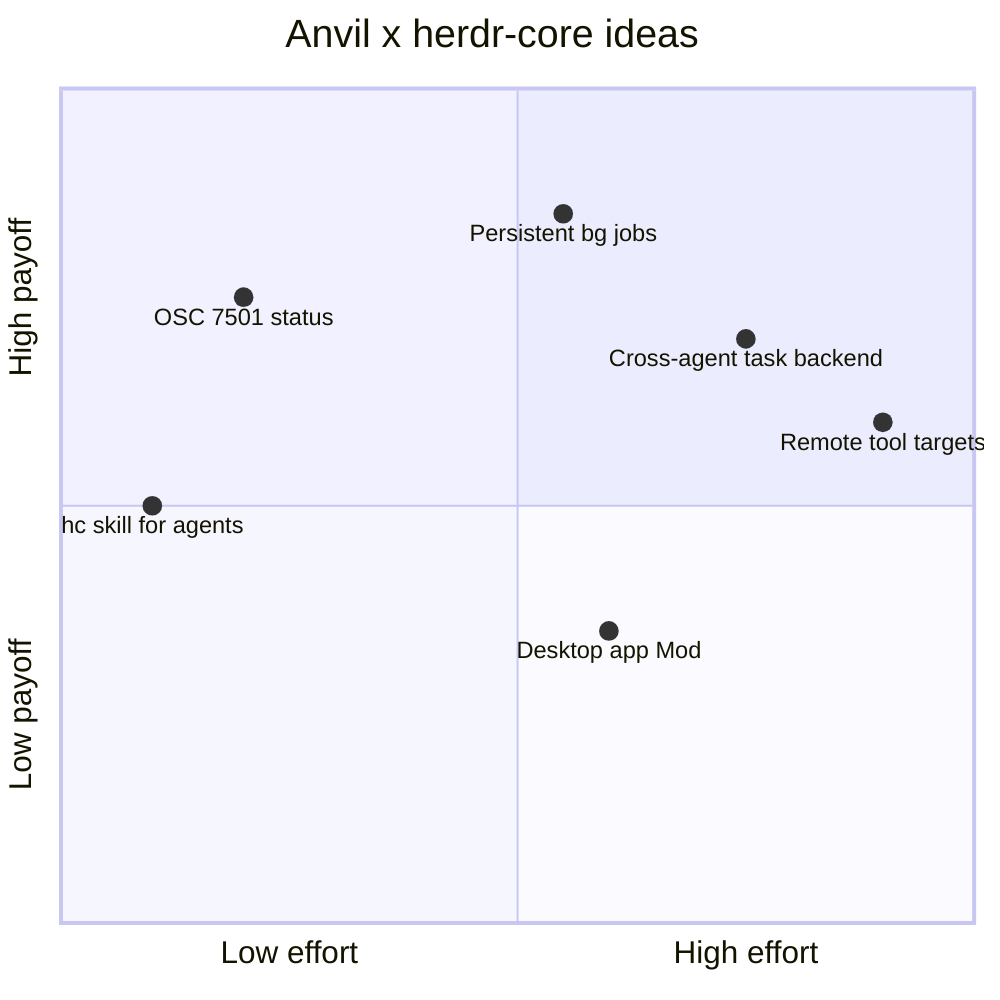

# Research: herdr-core and the Herdr desktop app

Date: 2026-10-30
Status: **NEEDS FURTHER EXPLORATION.** These are research notes and ideas
only. Nothing here is committed to or designed, and each idea needs its own
spike or design doc before anyone implements it. This file is the only record
of the conversation that produced it.

## TL;DR

On 2026-10-29 Herdr announced **herdr-core** (CLI `hc`), a new headless
engine, and a **desktop app** built on it. Both are open source under
Apache-2.0. Core changes three things that matter to Anvil:

- Programs report their status by writing an escape sequence to their own
  terminal (OSC 7501), not by calling a CLI.
- Terminals persist until someone stops them, and any program can start,
  read, message and wait on them.
- Remote machines are a flag (`--on box`).

The cheapest win is a spike that emits OSC 7501 next to today's
`herdr pane report-agent` calls. The biggest win is probably backing Anvil's
background jobs with `hc`, so dev servers outlive Anvil.

## Sources and confidence

A research sub-agent gathered these findings. I haven't installed or run
`hc` or the app, so treat command names and flags as what the docs say, not
as verified behaviour. The API is labelled preview (protocol generation 1,
version 0.x).

- Announcement thread: https://x.com/herdrdev/status/2115841099575222765
  (2026-10-29). App teaser: https://x.com/herdrdev/status/2112306397522034903
  (2026-10-19).
- Core: https://herdr.dev/core, https://github.com/herdrdev/herdr-core
  (also `docs/commands.md` and `schema/README.md` in that repo).
- App: https://github.com/herdrdev/herdr-app and its `CHANGELOG.md`.
- TUI: https://github.com/herdrdev/herdr/releases,
  https://herdr.dev/tui/docs/socket-api/, https://herdr.dev/docs/integrations,
  https://herdr.dev/docs/add-herdr-support/.
- Cloud waitlist: https://herdr.dev/cloud.

I found no launch blog post. The herdr.dev blog index the sub-agent fetched
ended at 2026-09-08.

## What was announced

### herdr-core (`hc`)

Core is a new engine, not a refactor of the TUI's. Herdr says it is "leaner
and more capable than the tui's engine" and "built for you to build on". It
draws no UI.

| Area | What it does | Commands (per docs) |
|---|---|---|
| Persistent terminals | Terminals keep running until stopped, including through `hc update` and `hc server restart`. | `hc run cargo test` (foreground), `hc run --bg --name web bun dev`, `hc ls`, `hc attach web` (Ctrl+\ detaches), `hc read web --lines 100`, `hc run --keep` |
| Agent orchestration | Agents started inside an hc terminal are its children. Children end with their parent unless started with `--outlive-parent`. The parent is told when a child needs attention or ends. | `hc wait --children all\|any`, `hc send` (with `--if idle\|working`, `--wait`, `--force`), `hc interrupt`, `hc templates`, `hc run reviewer "..."`, `hc --skill` (prints the agent manual) |
| Status | Core "draws nothing and guesses nothing". A terminal has a status (idle, working, done, blocked, error) only if its program reports one through OSC 7501, the "Program Status Protocol". Core does no screen scraping and keeps no list of known agents. | `printf '\e]7501;state=blocked:app=my-agent\e\\'`, `hc get <t>`, `hc events --terminal/--children-of/--label` |
| Remote machines | Terminals on another machine join the same list. | `hc machine add my-ssh-host --name box`, `hc run --on box --cwd /srv/app cargo test`, `hc attach box/t3`, `--via` for custom transports, `--temp` for sandboxes, `hc machine update`, `ssh box hc connect` |
| Exec and files without a terminal | Returns exactly what the program wrote and exits with its code. The timeout defaults to 60s, max 600s. | `hc exec [--on m] <cmd>` (`-i` pipes stdin), `hc file read\|write\|edit [--on m]` (exact-text edits) |
| Misc | | `hc put <t> <file>`, `hc keys`, `hc label k=v`, `hc kill` |
| Client API | JSON-RPC 2.0, one message per line, over a Unix socket or Windows named pipe. A framed mode carries attach streams with credit-based flow control. The API is additive only, enforced by a test against `released.openrpc.json`. | `hc schema` / `rpc.discover` (OpenRPC + JSON Schema), `events.subscribe` (snapshot, then events with a `seq` number, heartbeats and `missed`), `doc.get` / `doc.set` (opaque versioned JSON) |

The site's orchestration example:

```bash
hc run --bg --name review codex "review src/x.rs. Done: hc send $HC_TERMINAL_ID"
hc wait review
hc read --lines 60 review
hc send review "also check the tests"
```

### Herdr desktop app

The app is a GPU-rendered Rust GUI built on core. Terminals and agents live
in core, so closing, updating or crashing the app doesn't stop them.

- **Layout:** work is organised into spaces, tabs and panes.
- **Agents sidebar:** shows Working, Blocked, Done and Idle for programs
  that report status. 0.1.4 added priority sort and pinning.
- **Workers without a pane:** workers that another agent started appear in
  the sidebar, and clicking one opens a "peek" over the current tab.
  Ctrl/Cmd-clicking a terminal address like `t7` or `vps/t7` also peeks.
- **Remote spaces:** machines added over SSH run their spaces there, so
  those spaces keep going when the laptop sleeps.
- **Layouts and Mods:** Mods are JavaScript programs that draw panels,
  menus and dialogs. They are trusted code, not sandboxed.
- **For agents:** `herdr-app --skill`, `herdr-app ls`, `status` and
  `commands`. `herdr-app shot` (0.1.5) saves a picture of the window.
- **Migration:** 0.1.6 added a welcome screen with "one line for your agent
  to bring your keybinds and settings across" from the TUI. Core updates
  with the app.
- **Telemetry** is on by default (Settings → Privacy turns it off).

Releases went 0.1.4 (Oct 23) to 0.1.9 (Oct 30), so the app is moving fast.

### The existing TUI

Herdr's FAQ: the TUI "stays and keeps getting updates. nothing changes for
you." Its last tagged release is still v0.9.5 (2026-10-14), with about 39
fix commits on master since. Anvil's current integration targets this TUI
and keeps working.

## How Anvil integrates today

`internal/herdr` reports to the TUI by running the `herdr` CLI as a
subprocess (`docs/herdr/README.md`,
`plans/completed/design-2026-10-08-herdr-integration.md`):

- `herdr pane report-agent <pane> --source ... --agent anvil --state ...
  --seq N`, plus the session ID and a resume command
  (`internal/herdr/reporter.go`, `resume.go`).
- `herdr pane release-agent` on exit.
- `pane get` and tab rename calls to name the tab after the session
  (`tab.go`).
- Activation needs `HERDR_ENV`, `HERDR_PANE_ID`, a socket at
  `HERDR_SOCKET_PATH` and an absolute `herdr` binary (`env.go`). Reports are
  debounced and retried with backoff (`reporter.go`).
- The terminal title is set through Bubble Tea's `WindowTitle`
  (`internal/ui/model/ui.go`).

None of this reaches core. Core reads status only from OSC 7501, and has no
`report-agent` command.

## Ideas for Anvil

Rough positioning, by my judgement only:



### 1. Report status through OSC 7501

Emit `state=idle|working|blocked` with `app=anvil` as an escape sequence
from the TUI whenever the reported state changes, alongside the existing CLI
reporter.

- **Why:** it needs no subprocess, socket or binary lookup, and no retries.
  It works anywhere the bytes reach core, including SSH and core's remote
  machines. Output from the bash tool can't spoof it, because Anvil
  captures child process output.
- **Precedent:** Anvil already writes raw escape sequences through
  `tea.Raw` / `tea.RawMsg` for Kitty graphics (`internal/ui/image/image.go`)
  and capability queries (`internal/ui/common/capabilities.go`). The state
  snapshot in `internal/ui/model/herdr.go` already holds the value to send.
- **Open questions:**
  - Do the TUI and other terminals ignore OSC 7501 safely?
  - Does it need tmux passthrough the way Kitty graphics do (see
    `ansi.TmuxPassthrough` in `image.go`)?
  - Which grammar holds the session ID or a title, if any?
  - How does Anvil detect core? What env vars does an hc terminal set
    besides `HC_TERMINAL_ID`?
  - Should a child Anvil stay silent, the way `ANVIL_HERDR_REPORTING` does
    today?
- **Effort:** small. This is the first spike to run.

### 2. Give agents `hc --skill`

Wrap the output of `hc --skill` (and maybe `herdr-app --skill`) as a skill.
Agents could then start Codex, Claude Code or another Anvil in visible,
persistent terminals, wait on them and read their output.

- **Why:** it gives cross-model second opinions today with no Go changes.
  Anvil's `task` subagents all run in-process on Anvil's own providers.
- **Overlap:** the `manage-nodeterm-canvas` skill already does something
  similar for nodeterm. Decide whether these share a shape.
- **Effort:** trivial to try. The open question is whether the agent
  manual is stable enough to vendor, or should be generated on load.

### 3. Back background jobs with `hc`

Today Anvil's background jobs die when Anvil exits (see the job tools' docs
and `internal/shell`). An `hc` backend for `run_in_background` would map:

| Anvil | hc |
|---|---|
| start a job | `hc run --bg --name <job>` |
| `job_output` | `hc read <job>` (needs an offset or cursor for "new output since last read") |
| `job_kill` | `hc kill <job>` |
| `job_list` | `hc ls --label anvil.session=<id>` |
| completion notification | `hc events` (finished) |

- **Why:**
  - Dev servers and watchers survive `/reload-instance`, crashes and
    upgrades.
  - You can `hc attach` to a job the agent started.
  - Several Anvil instances could share one server instead of each starting
    their own. This is step (3) of `docs/adr/0005-cross-instance-sharing.md`:
    use the resource's own sharing mode.
- **Open questions:**
  - Does `hc read` support incremental reads?
  - How do job IDs persist? Anvil job IDs are unique across restarts, and
    hc terminal names may not be.
  - What happens to a job when its Anvil session is deleted?
  - Should this be opt-in per job or global?
- **Effort:** medium, with a design doc. The shell package's job model is
  the seam.

### 4. Use core as a `task` / workflow `agent()` backend

A subagent could be an external agent in an hc terminal. Its status would
come from `hc events` and its result from `hc wait` plus `hc read`, or from
a convention where the child calls `hc send $PARENT ...`.

- **Why:** it lets you orchestrate agents in other harnesses from Anvil
  workflows, and they stay visible in the Herdr sidebar.
- **Friction:**
  - Leases, `subagents` / `subagent_calls` rows, cost roll-up
    (ADR 0009) and `subagent_injection` steering all assume an in-process
    child session.
  - An external agent's cost and transcript are opaque to Anvil.
  - Results would be scraped terminal text, unless the child reports
    through `hc send` or `doc.set`.
- **Effort:** large. Try idea 2 first and see whether a skill is enough.

### 5. Point tools at a remote machine

`hc exec --on box` and `hc file read|write|edit --on box` map closely onto
`bash`, `view` and `edit`. A per-session "target machine" could run Anvil's
tools on a remote box while the TUI stays local.

- **Why:** long agent runs keep going on a server while the laptop sleeps,
  and heavy builds run off the laptop.
- **Friction:**
  - Permissions, path handling (`filepathext.SmartJoin`), LSP, the file
    tracker, grep and glob all assume a local filesystem.
  - `hc exec`'s 600s cap is shorter than some builds.
- **Effort:** very large. Running all of Anvil on the remote machine inside
  an hc terminal gets most of the benefit for free. Try that first.

### 6. Build a desktop app Mod for Anvil

A JS panel could show Anvil sessions, cost, workflow runs and pending
approvals, reading the global SQLite database or a small `anvil` CLI
surface.

- **Why:** it puts Anvil-specific state in Herdr's chrome.
- **Friction:** Mods are unsandboxed trusted code, and the Mod API is new.
  The payoff is low next to ideas 1 and 3.
- **Effort:** medium.

### Smaller notes

- `herdr-app shot` could help verify Herdr-facing UI changes, but the
  `terminal` MCP already covers Anvil's own TUI testing
  (`tui-manual-testing`).
- Core keeps terminals alive across app restarts, so Anvil's resume command
  (`anvil --session <id> --there`) matters less under core. It still matters
  when core itself is stopped. Check whether core has an equivalent of
  `report-agent`'s resume argv.
- `doc.get` / `doc.set` (versioned opaque JSON) could hold small amounts of
  shared state across Anvil instances, for example "which instance owns the
  dev server".

## Ideas for the dev workflow

- Run each wtp worktree's dev server and tests as named hc terminals (for
  example `web-<branch>`). They outlive Anvil, and any agent or human can
  `hc read` or attach to them.
- Have parallel Anvil instances across worktrees, plus an external reviewer
  agent, all show in one sidebar with self-reported (not scraped) blocked
  and done status. This needs idea 1.
- A remote box (on GCP, per the approved stack) running Anvil in an hc
  terminal keeps long runs alive while the laptop sleeps, and you can attach
  from the app.
- Herdr's own recipes are written as one agent handing work to a helper
  through `hc`. That's a usable pattern for "write, then review in another
  model" loops.

## Caveats and risks

- **Preview API.** Core's protocol is version 0.x. It is additive-only by
  policy, but expect churn. Keep everything behind the `internal/herdr`
  seam, and keep the TUI path working while both exist.
- **Two Herdrs.** The TUI and core have different status models: CLI plus
  screen detection for the TUI, OSC 7501 only for core. Anvil should
  support both for now, and detect which one it is in rather than guess.
- **Unverified details.** Everything above comes from docs and posts the
  sub-agent read, not from running `hc`. Verify command names, flags and
  the OSC grammar before designing against them.
- **Testing isolation.** The rule from the TUI integration still applies:
  never test against the user's real Herdr session. Work out how to run an
  isolated core server (separate socket or state dir) before any spike.
- **Telemetry and installs.** The app sends usage telemetry by default. Both
  install with `curl | sh`. On a Eucalyptus machine, install through Iru
  Self Service, or raise a ticket with Freddy in Slack if it isn't
  available.
- **Mods are unsandboxed.** Any Mod we ship or install runs as trusted code.
- **Fast-moving app.** It went through six releases (0.1.4 to 0.1.9) in a
  week. Pin versions in anything automated.

## Suggested next steps

1. Install core and the app in isolation, then confirm the OSC 7501
   grammar, the env vars an hc terminal sets, and how the TUI reacts to the
   sequence.
2. Spike idea 1: emit OSC 7501 from the TUI next to the CLI reporter.
3. Write a design doc for idea 3 (hc-backed background jobs), starting from
   the job tools' current model.
4. Try idea 2 by hand (`hc --skill` loaded as a skill) before deciding
   whether idea 4 is worth designing.
