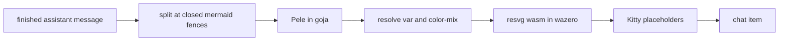

# Spike: rendering Mermaid diagrams inline

Branch `spike/mermaid-render`. Throwaway code to answer whether Anvil can
turn the Mermaid fences agents write into images in the chat.

## Answer

Yes. The pipeline works end to end in pure Go (CGO off):

## What's in the branch

- `internal/mermaid`: Pele 1.7.0 (`pele.global.js`, MIT) runs in goja.
  It measures text with DejaVu Sans read via `x/image/font/sfnt`. resvg 0.44
  rasterizes through `internal/mermaid/resvg`, a rewrite of the Go side of
  `github.com/boolean-maybe/go-resvg` v0.0.2 (Apache-2.0) around its
  `resvg.wasm` (wazero, DejaVu Sans built in). See Memory below for why
  it isn't a dependency.
- `internal/ui/model/mermaid.go`: a feature that renders on one worker
  goroutine and sends the image to the terminal with the existing
  `internal/ui/image` Kitty path. Once the terminal has it, the feature
  invalidates the chat. The worker loads the engines on the first diagram
  and drops them after 2 minutes idle.
- `internal/ui/chat/diagrams.go`: when a finished assistant message has a
  diagram ready, it is rendered in segments with the image in place of the
  fence. Any other case keeps the normal render, so the code block stays.

## Measurements (M-series Mac)

| Step | Cost |
| --- | --- |
| Load Pele into goja | ~80 ms, once |
| Compile resvg wasm | ~290 ms, once, on the first diagram |
| Pele render | 0.6–2.5 ms |
| Rasterize at 2x | 6–30 ms |
| Binary size | +7.6 MB (136.1 to 143.7 MB) |

## Memory

Nothing loads until the first diagram renders.

| What | Process memory | Go heap |
| --- | --- | --- |
| Pele in goja | +48 MB | +13 MB |
| resvg compiled and started | +48 MB | +2.5 MB |
| Per transmitted diagram | its RGBA pixels, about 2.5 MB for 80x40 cells at 10x20 px | same |

- **The upstream wrapper leaked.** `go-resvg` pooled instances in a
  `sync.Pool` and also kept each one for `Close`. Every GC emptied the
  pool, so the next render made a new instance (about 5 MB) and the old
  one was never freed. Its runtime and compiled code were also
  package-level, so the ~48 MB could never be given back. The vendored
  `resvg.Engine` owns its runtime and its one instance, and `Close` frees
  all of it. `TestRenderAcrossGCsDoesNotGrow` covers this: heap stayed
  flat over 3,200 renders, where upstream grew ~30 MB per 800.
- **WASM memory never shrinks.** Typical diagrams settle at ~10 MB. After
  a render that grows it past 32 MB, the engine drops the instance and
  starts the next render from a fresh one. `Rasterize` refuses images over
  4096x2048 pixels.
- **Idle release.** The worker drops both engines 2 minutes after the last
  render. The Go heap returns to baseline. Process memory on macOS falls
  only when the OS reclaims the freed pages, which it does under memory
  pressure.
- **Image cache.** When a diagram finishes transmitting, the feature drops
  copies at other widths (after a resize), then the least recently drawn
  until the rest fit 32 MB. Each dropped image is also deleted from the
  terminal (`a=d,d=I`). An evicted diagram renders again if it's drawn.

## Problems found and how the spike handles them

- **resvg ignores CSS `var()`.** Pele uses it for every colour.
  `ResolveVars` substitutes them from a `Theme` map before rasterizing.
  Because the colours are fixed at render time, that is also where Anvil's
  theming happens.
- **resvg ignores the root `font:` shorthand,** so every label fell back to
  12px. The spike adds an explicit `font-size` to the root element.
- **resvg can't parse `color-mix(in srgb, ...)`,** which Pele uses for
  nested cluster titles. The spike evaluates it in Go.
- **Translucent subgraph fills** picked up white from the transparent canvas.
  The spike paints the theme background behind the diagram first.
- **Pele's default width table made labels overflow their boxes** in
  DejaVu. Passing a `measurer` backed by the same font fixes it.
- **Herdr stretches Unicode-placeholder images to their grid**
  (herdrdev/herdr#4858). The spike pads each image to whole cells so the
  aspect ratio survives.

## Not verified

- **Seeing the image in a real Kitty-capable terminal.** The terminal MCP's
  emulator can't draw images. It confirmed the fallback: without Kitty
  support the code block renders as before. A model test checks the Kitty
  path with faked capabilities, but it only goes as far as the placeholder
  output. Run `/tmp/anvil-spike` in Ghostty and inside Herdr and ask for a
  diagram.
- **Behaviour on resize** (it should re-render per width; the cache key
  includes width), scrolling, compact mode and selection over an image.

## If this goes ahead

- Pass the renderer through the item constructors instead of the
  package-level `chat.Diagrams` hook.
- Build the theme from `styles.Styles` instead of the hard-coded TokyoNight
  map.
- Reconsider resvg's fonts: they are fixed at build time in the vendored
  wasm. Rebuilding it from `go-resvg`'s Rust crate would let us supply
  our own.- Decide what happens with large diagrams. They are currently scaled down to
  40 rows. A drill-in at full size or "open SVG in browser" may be better.
- Check how `gocognit`, `depguard` and mutation testing treat the new
  package before building on it.
